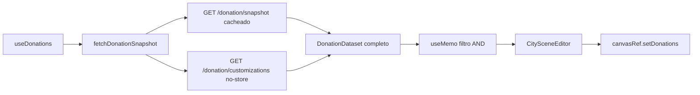

# Camada de API — Doações

Camada **só de dados**. Zero Three.js, zero React fora do hook. Busca doações do backend, aplica filtro client-side, entrega pro editor. Vive em `src/api/` (dados puros) + `src/components/hooks/useDonations.ts` (ponte React).

> [!important] Estilo de escrita
> Modo homem das cavernas. Corta artigo, enchimento, hedge. Fragmento OK.

## Por que existe

Antes: prédios nasciam no front (`INITIAL_TEST_DONATIONS`, 10 valores hardcoded). Agora: vêm do backend, snapshot cacheado, escala 100k+. IDs do backend preservados.

## Arquivos

| Arquivo | Papel |
| --- | --- |
| `src/api/http.ts` | Instância axios. `baseURL = VITE_API_URL ?? "/api"`. Normaliza erro → `ApiError {status, message}`. |
| `src/api/donationApi.ts` | `fetchDonationSnapshot()` — busca snapshot + personalizações atuais em paralelo, mapeia tuplas → objetos. `fetchMyDonations()` — `GET /donation/me`, edifícios da sessão completos (`DonationRecord[]`). `saveDonationCustomization()` — PUT da personalização. Tipos `DonationRecord`/`City`/`Ong`/`DonationDataset`. |
| `src/api/regions.ts` | `UF_REGION` (27 UFs → 5 regiões) + `REGIONS`. Região é função fixa da UF — não vem do backend. |
| `src/components/hooks/useDonations.ts` | Hook. Carrega snapshot, guarda dataset, aplica filtro (`useMemo`), expõe `loadState`/`donations`/`allDonations` (sem filtro)/`cities`/`ongs`/`savedCustomizations`/`filter`/`setFilter`/`retry`. |
| `src/components/hooks/useOwnedDonationIds.ts` | Hook. `ids` (`Set`) + `records` da sessão via `fetchMyDonations`; `refresh()` relê após pagamento. Refaz ao trocar `user.id`; vazio sem login, carregando ou em erro. Ver [[#Quem pode editar]] e [[#Edifícios do usuário no login]]. |

## Contrato do snapshot

`GET /donation/snapshot` (proxy Vite `/api` → back). Formato compacto por tuplas:

```json
{ "v": 5, "total": 100000,
  "cities": [[2800308, "Aracaju", "SE"]],
  "ongs": [[1, "Instituto X", null]],
  "data": [[1, 42.5, 3550308, 7]],
  "custom": [[1, { "color": "#ffd700", "buildingShape": "twisted", "…": "…" }]],
  "beneficiaries": [[1, [7, 8]]] }
```

`ongs`: `[id, nome, profile_imageOuNull]`, só ativas. `Ong.profile_image` opcional no front: tupla antiga sem imagem vira `null`. Nome, foto e status administrados em [[ongs]]; cartões públicos usam foto ou iniciais. Cache do backend detecta exclusões pela contagem de ONGs, edições pela data com precisão fracionária; atualização em até 30 s, recebida ao recarregar dataset.

`data`: `[id, value, cityId, ongId]`. `fetchDonationSnapshot` desdobra em objetos `DonationRecord`.

`ongId` = ONG original, mantida na tupla por compatibilidade. `beneficiaries`: `[donationId, ongIds][]`, só edifícios com várias ONGs. `DonationRecord.ongIds` usa complemento ou `[ongId]` no snapshot antigo/edifício com uma ONG. Edifício aparece no filtro de qualquer ONG apoiada; card/menu mostram todos os nomes. Valor/altura continuam usando total acumulado.

`custom`: cópia cacheada mantida no snapshot por compatibilidade. Não é mais fonte da hidratação porque pode ficar desatualizada por até 30s.

`GET /donation/customizations`: `[donationId, BuildingCustomization][]`, só dos edifícios personalizados. Resposta `Cache-Control: no-store`, lida direto do banco em cada carga. `fetchDonationSnapshot` dispara as duas requisições em paralelo e usa esta resposta para montar `DonationDataset.customizations` (Map).

## Gotcha: barra de progresso com gzip

Resposta vem `Content-Encoding: gzip`. Browser zera `ProgressEvent.total` e conta `loaded` em bytes **descomprimidos**. Logo `Content-Length` (tamanho gzip) não serve de denominador.

Solução: back manda header `X-Snapshot-Bytes` = tamanho do JSON raw. `donationApi` lê ele via `event.event?.target.getResponseHeader(...)` (headers chegam antes do body). Sem o header → `totalBytes: null` → overlay mostra só MB carregados, sem %.

## Filtro client-side

Dataset inteiro já é **público** (id, valor, cidade, ONG — sem dado de doador). Filtrar no front NÃO delega segurança ao cliente — só escolhe o que renderizar. ~5ms p/ 100k.

Predicado AND no `useMemo`:
- `ongId` combina com qualquer nível de local; corresponde a qualquer item de `DonationRecord.ongIds`.
- Local usa o mais específico presente: `cityId` > `uf` > `region`.
- Região deriva da UF via `UF_REGION[cidade.uf]`.
- `cityById` (Map) montado 1× pra lookup O(1).

Sem filtro → retorna array original (mesma referência, evita rebuild à toa).

## Fluxo



Editor chama `setDonations(donations)` a cada mudança de `donations` (load inicial + troca de filtro). Replace-all na cena — doação manual local é descartada ao trocar filtro. Ver [[scene-managers#setDonations]].

## Personalização persistida

Antes: painel mexia só no state do React — recarregou a página, sumiu. Agora vai pro banco (`donation.customization`).

**Leitura** — vem de `/donation/customizations`, sem cache, em paralelo ao snapshot pesado. `useDonations` só fica `ready` quando ambas terminam e expõe `savedCustomizations`. O editor atualiza state + ref no mesmo efeito e reaplica na cena logo depois de cada `setDonations` (replace-all só preserva o que já estava na cena, então o que veio do banco — e o que voltou pelo filtro — precisa ser reaplicado).

**Escrita** — `updateCustomization` do editor é o ponto único: aplica na cena, guarda no state e agenda `saveDonationCustomization`. Debounce de 500ms **por edifício** (`pendingSaves`): cor e opacidade disparam a cada frame de arrasto; sem isso um slider vira dezenas de PUTs. Um timer por `donationId` — editar A e depois B não pode cancelar o save de A. Desmontar dentro da janela do debounce dispara os pendentes em vez de descartá-los.

**Erro** — toast ([[componentes-html#Notificações (toast)]]), id `save-customization-<donationId>`: falhas seguidas do mesmo prédio substituem em vez de empilhar; próximo save ok fecha. Status lido de `ApiError` (interceptor do `http` nunca rejeita com `AxiosError` — checar `axios.isAxiosError` aqui dava sempre falso e todo erro caía no genérico). `400`/`403` repetem a mensagem do backend (opção travada, item desligado); `401` pede login; `404` = prédio de outro usuário. Rede/5xx → genérico + botão **Tentar de novo**, que regrava o estado **atual** do prédio (`customizationsRef`), não o da tentativa falha.

### Quem pode editar

`canEdit(id) = isAdmin || ownedDonationIds.has(id)` no `CitySceneEditor`. Clique no prédio abre [[html-components#BuildingInfoModal.tsx|BuildingInfoModal]] (só leitura) pra todos; **Administrar** só aparece se `canEdit`. [[html-components#BuildingManageDialog.tsx|Administração]] também tem gate no render: sessão cai (logout/401) → diálogo some sozinho. Não depende de Pix nem cria cobrança.

`GET /donation/me` (JWT, `no-store`) → `{ data: DonationRecord[] }` (`id`, `value`, `cityId`, `ongId`, `ongIds`), edifícios ativos da sessão. Só UX: autorização real continua no `WHERE` do PUT (404 em prédio alheio). Pagamento confirmado → `refresh()` relê lista.

### Edifícios do usuário no login

Snapshot público tem cache ≤30 s no back + `max-age=30` no HTTP: edifício pago agora pode faltar nele. `CitySceneEditor` mescla `records` de `/donation/me` no dataset via `upsertDonations` assim que snapshot fica `ready` e a cada releitura (login, troca de conta, pagamento). Registro igual ao do snapshot = no-op, sem rebuild da cidade. Edifício maior/novo entra na hora.

> [!note] Local sem dono
> Prédios de teste (`/admin/test-buildings`) nascem com `user_id NULL`: ninguém além do admin edita. Pra testar fluxo de dono: `UPDATE donation SET user_id = <userId> WHERE id = <donationId>;`

> [!warning] Otimista de propósito
> A cena muda antes do PUT responder. Falhou, o toast avisa mas a cena **não** volta atrás — recarregar a página restaura o que o banco tem. Reverter exigiria desfazer o state local do painel, que tem cópia própria dos valores.

Contrato da rota, autorização e cobrança de liberação: `doc/modulos/personalizacoes/personalizacoes.md` no vault do backend.

## Estados de carga

`DonationsLoadState`: `loading` (bytes) → `ready` (count) | `error` (message). `retry()` reseta pra `loading` e refaz o fetch (dep `reloadKey`). `AbortController` cancela no unmount (StrictMode roda 2× em dev — abort ignora).

## Segurança

- Endpoints de leitura aceitam **zero input** (sem body/params/query) — superfície de injeção nula.
- Proxy Vite = DX de dev (mata CORS local), **não** é segurança. Produção: reverse proxy same-origin ou `VITE_API_URL` + `CORS_ORIGINS` estrito no back.
- Nunca confiar no front pra esconder dado: se algo deixar de ser público, sai do snapshot no backend — não se filtra pra esconder.

## Relacionado

- [[html-components#DonationLoadOverlay.tsx]] — overlay de carregamento
- [[html-components#DonationFilterBar.tsx]] — barra de filtros
- [[scene-managers#setDonations]] — replace-all na cena
- [[customization-api]] — catálogo de opções e regra de liberação
- [[three-components]] — handle `setDonations`

## Acesso aos próprios edifícios

**Meus edifícios** no `AuthMenu` e **Ver meu edifício** na confirmação/toast de pagamento usam `handleOpenDonation(id, false)`: ativam `myBuildingsOpen`, ocultam interface geral e levam direto ao próprio. Card compacto no topo esquerdo, menor no mobile e limitado acima das setas; setas laterais em ciclo, **Personalizar/Detalhes** com fundo no rodapé e **X** para sair/restaurar UI. Conta/Pix continuam montados durante o modo; fechar detalhes/personalização retorna à navegação dedicada. A lista completa continua no `GameMenu`, acessível pelo avatar; **Ver na cidade** mantém o card normal. Contribuição aberta oculta seleção anterior. Oculta por filtro/teto → limpa ambos, aguarda rebuild e foca; X disponível durante a espera. `pendingFocusRef` só consumido quando edifício existe; suporta resposta atrasada de `/donation/me` após pagamento. Troca de conta/sair cancela foco e restaura UI. **Administrar/Personalizar** mantém posse validada; Pix fica em **Contribuir**.
