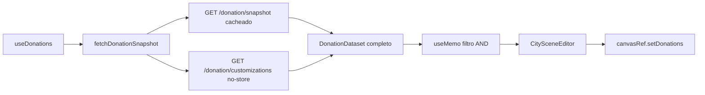

# Camada de API — Doações

Camada **só de dados**. Zero Three.js, zero React fora do hook. Busca doações do backend, aplica filtro client-side, entrega pro editor. Vive em `src/api/` (dados puros) + `src/components/hooks/useDonations.ts` (ponte React).

> [!important] Estilo de escrita
> Modo homem das cavernas. Corta artigo, enchimento, hedge. Fragmento OK.

## Por que existe

Antes: prédios nasciam no front (`INITIAL_TEST_DONATIONS`, 10 valores hardcoded). Agora: vêm do backend, snapshot cacheado, escala 100k+. IDs do backend preservados.

## Arquivos

| Arquivo | Papel |
| --- | --- |
| `src/api/http.ts` | Instância axios. `baseURL = VITE_API_URL ?? "/api"`. Normaliza erro → `ApiError {status, message}`. |
| `src/api/donationApi.ts` | `fetchDonationSnapshot()` — busca snapshot + personalizações atuais em paralelo, mapeia tuplas → objetos. `saveDonationCustomization(userId, id, customization)` — gravação local; nenhuma escrita HTTP. Tipos `DonationRecord`/`City`/`Ong`/`DonationDataset`. |
| `src/api/regions.ts` | `UF_REGION` (27 UFs → 5 regiões) + `REGIONS`. Região é função fixa da UF — não vem do backend. |
| `src/components/hooks/useDonations.ts` | Hook. Carrega snapshot, guarda dataset, aplica filtro (`useMemo`), expõe `loadState`/`donations`/`allDonations` (sem filtro)/`cities`/`ongs`/`savedCustomizations`/`filter`/`setFilter`/`retry`. |
| `src/components/hooks/useOwnedDonationIds.ts` | Hook. `ids` (`Set`) + `records` locais da conta; assina alterações após simulação. Vazio sem login; outra conta usa outras chaves. Ver [[#Quem pode editar]] e [[#Edifícios do usuário no login]]. |

## Contrato do snapshot

`GET /donation/snapshot` (proxy Vite `/api` → back). Formato compacto por tuplas:

```json
{ "v": 4, "total": 100000,
  "cities": [[2800308, "Aracaju", "SE"]],
  "ongs": [[1, "Instituto X"]],
  "data": [[1, 42.5, 3550308, 7]],
  "custom": [[1, { "color": "#ffd700", "buildingShape": "twisted", "…": "…" }]],
  "beneficiaries": [[1, [7, 8]]] }
```

`data`: `[id, value, cityId, ongId]`. `fetchDonationSnapshot` desdobra em objetos `DonationRecord`.

`ongId` = ONG original, mantida na tupla por compatibilidade. `beneficiaries`: `[donationId, ongIds][]`, só edifícios com várias ONGs. `DonationRecord.ongIds` usa complemento ou `[ongId]` no snapshot antigo/edifício com uma ONG. Edifício aparece no filtro de qualquer ONG apoiada; card/menu mostram todos os nomes. Valor/altura continuam usando total acumulado.

`custom`: cópia cacheada mantida no snapshot por compatibilidade. Não é mais fonte da hidratação porque pode ficar desatualizada por até 30s.

`GET /donation/customizations`: `[donationId, BuildingCustomization][]`, só dos edifícios personalizados. Resposta `Cache-Control: no-store`, lida direto do banco em cada carga. `fetchDonationSnapshot` dispara as duas requisições em paralelo e usa esta resposta para montar `DonationDataset.customizations` (Map).

## Gotcha: barra de progresso com gzip

Resposta vem `Content-Encoding: gzip`. Browser zera `ProgressEvent.total` e conta `loaded` em bytes **descomprimidos**. Logo `Content-Length` (tamanho gzip) não serve de denominador.

Solução: back manda header `X-Snapshot-Bytes` = tamanho do JSON raw. `donationApi` lê ele via `event.event?.target.getResponseHeader(...)` (headers chegam antes do body). Sem o header → `totalBytes: null` → overlay mostra só MB carregados, sem %.

## Filtro client-side

Dataset inteiro já é **público** (id, valor, cidade, ONG — sem dado de doador). Filtrar no front NÃO delega segurança ao cliente — só escolhe o que renderizar. ~5ms p/ 100k.

Predicado AND no `useMemo`:
- `ongId` combina com qualquer nível de local; corresponde a qualquer item de `DonationRecord.ongIds`.
- Local usa o mais específico presente: `cityId` > `uf` > `region`.
- Região deriva da UF via `UF_REGION[cidade.uf]`.
- `cityById` (Map) montado 1× pra lookup O(1).

Sem filtro → retorna array original (mesma referência, evita rebuild à toa).

## Fluxo



Editor chama `setDonations(donations)` a cada mudança de `donations` (load inicial + troca de filtro). Replace-all na cena — doação manual local é descartada ao trocar filtro. Ver [[scene-managers#setDonations]].

## Personalização persistida

Pré-lançamento: edição salva no localStorage, nunca em `donation.customization`. `savedCustomizations` mescla personalização pública com a cópia local da conta. Editor reaplica após `setDonations`, preserva payloads pendentes e salva ao fechar/recarregar (`pagehide`). Debounce 500 ms por edifício; conta capturada no payload evita salvar uma edição na conta seguinte.

### Quem pode editar

`canEdit(id) = isAdmin || ownedDonationIds.has(id)`. Conta comum administra apenas IDs negativos da própria simulação. Admin altera cópia local de edifícios públicos. Logout/401 remove acesso à administração. Configurações da cena, botão e `Ctrl+M` apenas para admin.

### Edifícios do usuário no login

`useOwnedDonationIds`: lê edifícios locais, sem `/donation/me`. `useDonations`: mescla edifícios da conta no snapshot para renderização, sem incorporá-los ao dataset público. Troca de conta/logout remove registros anteriores imediatamente; a próxima conta restaura suas próprias chaves. Filtros usam cidades do snapshot mais cidades dos edifícios locais.

## Estados de carga

Snapshot continua com loading/progresso/erro/retry. Mutação local dispara evento específico da chave; outras abas recebem `storage`. Armazenamento inválido/cheio/bloqueado exibe erro e mantém dados gravados anteriormente.

## Acesso aos próprios edifícios

**Meus edifícios** abre lista local sem filtro. **Ver na cidade** limpa filtro/teto se necessário, aguarda rebuild, foca e abre informações. Troca de conta/fechar card cancela foco pendente. **Administrar** mantém abas Informações/Aparência. Valores do menu e da seção pública rotulados como simulados.

Detalhes: [[index#Pré-lançamento]], [[contribution-api]], [[html-components]].
