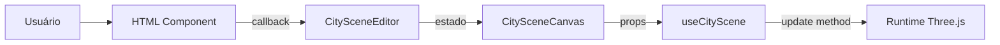

# HTML Components

Componentes React DOM do painel lateral do Cidoe.

> [!info] O que é "HTML" aqui
> Componentes que renderizam tags como `div`, `section`, `input`, `select` e `label`. Não são arquivos HTML estáticos — são componentes React puros de interface.

## Objetivo da Camada

A pasta `src/components/html` organiza todo o painel lateral sem misturar interface com lógica Three.js.

Esses componentes:
- mostram controles para o usuário
- recebem dados via `props`
- chamam callbacks quando o usuário altera valores
- **não** criam objetos Three.js
- **não** conhecem `scene`, `camera` ou `renderer`

## Carregamento inicial (casca)

Meta: 1º paint útil antes do bundle; Three.js não atrasa FCP/LCP. Lighthouse mobile local: FCP 3,0–3,4 s → 1,5 s; LCP 4,1–4,4 s → 2,0 s.

Decisão do dono: loading = só página de loading. **Nenhuma imagem** baixa nem aparece até ela sair; sai só com **tudo** carregado. Sem pôster da cidade (removido).

1. **`index.html`** — `#root` já traz `#scene-loading`: mesmo markup/classes do [[#DonationLoadOverlay.tsx|DonationLoadOverlay]] `cover` (fundo `bg-background`, card "Carregando doações…" + `BlockLoader` + "0.0 MB"). Classes resolvem no 1º paint em produção (CSS no `<head>`); em dev pisca sem estilo até o JS. Script inline remove fora de `/`. Mudou o card? Ajustar aqui também.
2. **`App.tsx`** — rota `/` com `Suspense` próprio: `SceneFallback` = `DonationLoadOverlay cover` com estado `loading`. React limpa `#root` no 1º commit e repõe o mesmo card → sem pisca, sem CLS, sem LCP novo.
3. **`afterPaint()`** (`App.tsx`) — duplo rAF (aba oculta resolve na hora). `CitySceneEditor` lazy só chama `import()` depois: casca (loading + `CookieNotice`) pinta antes de baixar/avaliar cena. Mesmo truque no `Toaster` — Radix Toast fora do `index.js`; store do toast vive fora do React, `toast()` antes do mount aparece quando monta.
4. **`CitySceneEditor`** — `<DonationLoadOverlay cover hidden={booted} />` logo após o canvas. `booted` liga **uma vez**: `loadState` pronto + `donationsApplied` + catálogo resolvido (pool de texturas) + `sceneReady` ([[scene-runtime#Desempenho (TBT e celular)]]: HDRI, shaders, fila de customização e nenhuma textura baixando). Lê `sceneReadyRef` (atualizado síncrono no `onStatsChange`), não o state: catálogo que chega troca o pool no effect do canvas, que roda antes e já derruba `sceneReady` — state ainda teria o `true` velho. Fade 500 ms; `transitionend` desmonta.
5. **Até `booted`** não montam: placa da marca (logo), `AuthMenu`, `ContributeDialog`, seta/engrenagem, [[#DonationInfoSection.tsx|DonationInfoSection]] (foto, avatares). Sem imagem, sem foco por Tab atrás do loading, sem diálogo de onboarding por cima. `CookieNotice` (texto, consentimento) segue visível.

> [!note] Custo
> Loading espera ~11 MB de fachadas do cenário inicial. Medido (headless, ~5 Mbps sem cache): última textura 11,24 s → loading sai 11,28 s; logo e foto começam a baixar no instante da saída. Sem WebGL: hook marca `sceneReady`, loading sai normal.

> [!warning] LCP
> LCP mobile = parágrafo do [[#CookieNotice.tsx|CookieNotice]] ou texto do card de loading (os dois no HTML/`index.js`). Logo: `index.js` enxuto, nada pesado antes do paint, preload só da Manrope latin.

- **Fontes** self-hosted — [[desingn-system-index#Tipografia]].
- **GIS** sob demanda — [[area-admin]] (`AuthDialog`).
- **nginx** (`docker/nginx.conf`) — `^~ /assets/`: `Cache-Control: public, max-age=31536000, immutable` (sem `always`: 404 de chunk não fica em cache). Arquivos de `public/` (webp/jpg/png/svg/woff2/ico): `expires 30d`. HTML: `no-cache`. gzip nível 6, ≥ 1 KB, + `text/plain`, `text/javascript`, `application/manifest+json`. `/api` e `/healthz` intactos.

## Componentes Principais

### Placa da marca (`CitySceneEditor.tsx`)

Placa compacta `pixel pixel-thin bg-background`, sem bisel. Logo oficial `public/logo.webp` 32px à esquerda (`alt=""`: nome já no texto) + duas linhas:
1. **Cidoe** 14px 600 + kicker mono verde **Pré-lançamento**.
2. **Pagamentos simulados. Cidade salva só neste navegador.**

Sem links (decisão do dono). Termos/Privacidade ficam no rodapé da [[#DonationInfoSection.tsx]] (seta inferior direita da cena) e no aviso de cookies. Marca visível na 1ª tela, sem rolar nem entrar = requisito da página inicial do login com Google ([[termos-e-privacidade#Página inicial — requisitos do Google]]). Texto 12px, entrelinha 16px, padding 8px horizontal / 6px vertical; `aside aria-label="Cidoe"`.

Ocupa apenas a largura do conteúdo, margem externa de 16px. Placa e menu sempre na mesma linha, espaço 8px; nunca quebra. Espaços vazios do cabeçalho deixam passar os gestos para a cena.

> [!note] Mobile (< `sm`)
> Placa vira só o kicker **Pré-lançamento** (altura 40px = botões). Logo, aviso e nome somem; **Cidoe** fica `sr-only`. Menu logado: avatar sem nome (`sr-only`), gap 8px. Cabe em 320px.

### `DonationInfoSection.tsx`

Seção abaixo da cena pública = home do projeto. Composição do [[desingn-system-index|DS]]: hero display → `01 Impacto` → `02 Explore as ONGs da cidade` → rodapé. Fundo `bg-background pattern-paws` (pegadas do DS, 420px). Container `max-w-[1240px]`, `pt-24 pb-[120px]` (mobile `pt-16 pb-24`). Cabeçalho de seção = `PixelPaw` + número mono verde + título 44px, gap 18px, conteúdo a 36px (`mt-9`). Espaço entre blocos: 128px (hero → 01), 112px (01 → 02), 120px (rodapé); mobile 80px em todos. Sem hairline: só espaço. Snapshot público mais simulações locais do mesmo `useDonations`; valores rotulados como simulados (**Valor simulado**, **ONGs na cidade**), sem arrecadação real. Hero e seção 02 com copy de pré-lançamento.

- Hero: kicker mono 13px com logo oficial `public/logo.webp` 48px antes (`loading="lazy"`, abaixo da dobra); título display (até 72px, `leading-[0.98]`, `max-w-[14ch]`); texto 22px `leading-normal` `muted-foreground` = o que o app faz (contribuição → edifício, valor → altura; cadastro, simulação, personalização, indicação); gap 32px. Política de Privacidade linkada só no rodapé.
- Impacto: placa `pixel bevel-edge bg-card` com total em display verde (Manrope); três placas contador (ícone pixel + número + `mono-label`). Soma em centavos, quantidade de edifícios, ONGs beneficiárias e cidades. Valores acompanham filtros da cena; teto de renderização vale só no canvas.
- Foto: `<Photo ratio="1/1">` ([[desingn-system-index#Moldura (5.3)|moldura do DS]], 3px, sem bisel) com `public/cat_dog.webp` e `public/cat_dog.jpeg` de reserva — JPG cópia idêntica da `video-2` (1024 × 947); 1:1 recorta só as laterais. `PixelDog` espia por cima (DS 6.6). Foto de banco: trocar por foto de ONG quando houver ([[desingn-system-index#Desvios conscientes]]).
- ONGs: no máximo **6 cartões** (DS 6.6, grade 1/2/3 colunas), por quantidade de edifícios apoiando; ONG selecionada permanece visível, desempate pelo nome. Cartão: `gap-3.5`; cidades (mono 11px), avatar 72px com `ong.profile_image` (fallback: iniciais; edição em [[ongs]]), nome 26px, edifícios 15px com número em `strong`, botão primário largura total **Ver na cidade**. ONG filtrada = `pixel-ink-verde bg-secondary` + selo **No filtro**. Sem barra de meta: API não expõe meta da ONG. Sem lista individual de edifícios.
- Rodapé (DS): frase 28px `max-w-[24ch]` à esquerda; à direita, mono 12px `muted-foreground`: links **Termos de Uso** e **Política de Privacidade** + rótulo. Link da política na home = exigência do Google para o login ([[termos-e-privacidade]]). `<a href>` simples (não `Link`): seção renderiza sem Router no `check-donation-info`.
- **Ver na cidade**: aplica `filter.ongId`, preserva localização e retorna suavemente ao canvas. Informações/perfil e administração continuam no acesso existente da cena. **Limpar filtros** reseta tudo.
- Loading = `BlockLoader`; erro + retry; estados vazios explícitos. Sem estimar percentual/repasse por ONG: snapshot só informa beneficiárias, não divisão dos valores.
- `CitySceneEditor`: mesma navegação da `video-2`. Setas usam `scrollTo` suave; botão **Voltar para a cena** fixo aparece após metade da viewport. Roda para baixo não tira usuário da cena; roda para cima no topo da seção retorna automaticamente. Painéis com scroll mantêm seu gesto; listeners removidos no unmount. Scrollbar oculta; runtime, API e autenticação preservados.
- Check: `node scripts/check-donation-info.mjs`; composição, foto, limite de ONGs, totais, filtros e eventos reais de navegação, sem servidor/navegador.

---

### `BuildingHeightInput.tsx`

Componente de depuração preservado no código, não montado na versão de pré-lançamento. Criação pública usa simulação persistida em `ContributeDialog`. Monta 3 sub-painéis empilhados, cada um liga/desliga independente via `visibility` (ver aba **tela** em [[#CityControlPanel.tsx]]):

1. **Doação individual** — `visibility.donationInput`
2. **Geração em lote** (mín/máx/qtd) — `visibility.bulkInput`
3. **Configuração de quadras** (bloco/rua/t·quadra/torres%/base%) — `visibility.blockLayoutInput`

**Responsabilidades:**
- Exibir input numérico para o valor da doação
- Ao clicar em "Doar" (ou pressionar Enter), chamar `onSubmit(value)`
- Suporte a `onBulkSubmit(values[])` para envio de múltiplas doações em lote
- Exibir inputs de layout de quadra: `bloco` (blockSize) e `rua` (streetWidth)
- Limpar o campo após cada envio bem-sucedido
- Esconder cada sub-painel conforme `visibility`
- Não conhece Three.js nem estado global

**Props:**
| Prop | Tipo | Descrição |
|---|---|---|
| `onSubmit` | `(value: number) => void` | Doação individual |
| `onBulkSubmit` | `(values: number[]) => void` | Lote de doações |
| `blockLayoutSettings` | `BlockLayoutSettings` | Tamanho de quadra e largura de rua |
| `onBlockLayoutChange` | `(s: BlockLayoutSettings) => void` | Atualiza layout em tempo real |
| `visibility` | `UIVisibilitySettings` | Quais sub-painéis mostrar (ver [[scene-types#UIVisibilitySettings]]) |

> [!note] Fluxo de doação
> Cada envio chama `canvasRef.addDonation(value)` em `CitySceneEditor`. O prédio de maior valor sempre ocupa o centro da quadra central.

---

### `BuildingLayoutCard.tsx`

Pré-lançamento: apenas admin, no canto inferior esquerdo. Layout e limite de renderização persistem localmente.

Card flutuante no canto superior esquerdo. Tira do painel os dois controles que mais se mexe ao compor a cidade: **modo de layout** e **quantos edifícios entram na cena**. Botão `×` no cabeçalho remove o card da tela (escreve `buildingLayoutCard: false`); aba **Tela** do painel devolve.

**Responsabilidades:**
- Par de botões que alterna `centerTallest` — **Por quadra** (`false`, padrão) = torres agrupadas nos slots centrais de cada quadra, menores embaralhados no meio; **Mais alto no centro** (`true`) = gradiente global, maior doação no centro exato e altura caindo pra borda. Quadras/ruas idênticas nos dois — ver [[scene-managers#Layout dos Prédios — 2 Modos]]
- Teto de edifícios na cena: input numérico + **aplicar** (ou Enter) + **tudo** (volta a `null` = sem teto)
- Rodapé conta `N de TOTAL doações` — total já é o pós-filtro do [[#DonationFilterBar.tsx]]
- Commit só no aplicar/Enter, nunca por tecla: cada mudança dispara replace-all na cena (`rebuildInstances` trava o frame ~0,5s com 100k)
- Sem estado global nem Three.js

**Props:**
| Prop | Tipo | Descrição |
|---|---|---|
| `settings` | `BlockLayoutSettings` | Só lê/escreve `centerTallest` |
| `onChange` | `(s: BlockLayoutSettings) => void` | Troca de modo |
| `visibleLimit` | `number \| null` | Teto atual, `null` = todos |
| `onVisibleLimitChange` | `(limit: number \| null) => void` | Novo teto |
| `total` | `number` | Doações disponíveis após o filtro |
| `onClose` | `() => void` | Remove o card da tela |

> [!note] Corte é por valor, não por ordem do dataset
> `CitySceneEditor` ordena por valor desc antes de cortar (`visibleDonations`), então o teto mantém as **maiores** doações. Lista completa passa direto, sem cópia nem sort.

---

### `DonationLoadOverlay.tsx`

Overlay de carregamento do snapshot de doações do backend ([[donation-api]]). Duas instâncias no editor:
- **`cover`** = página de loading inicial: fundo opaco `bg-background`, sem imagem, `pointer-events-auto` (bloqueia a cena). `hidden` → fade 500 ms e desmonta de vez. Ver [[#Carregamento inicial (casca)]].
- **sem `cover`** = rebuild por filtro após o boot: card sobre a cena visível.

**Responsabilidades:**
- Placa central: `BlockLoader` (ou `BlockBar` quando há total) + progresso por bytes (`X-Snapshot-Bytes`) ou só MB carregados quando o header não vem (gzip zera `total` — ver [[donation-api#Gotcha: barra de progresso com gzip]])
- Estado de erro: mensagem + botão **"Tentar novamente"** (chama `retry` do `useDonations`)
- Sem `cover`: fundo `pointer-events-none` — não bloqueia interação com a cena embaixo
- Mascara o **freeze do rebuild**: só some depois de `setDonations` aplicar (o `rebuildInstances` trava o frame; overlay cobre o congelamento). Vale pro load inicial **e pra troca de filtro** — o editor derruba `donationsApplied`, espera duplo `requestAnimationFrame` (garante 1 paint do overlay; rAF simples dispara antes do paint) e só então chama `setDonations`

**Props:**
| Prop | Tipo | Descrição |
|---|---|---|
| `state` | `DonationsLoadState` | `loading` (bytes) / `ready` (count) / `error` (message) — ver [[donation-api#Estados de carga]] |
| `onRetry` | `() => void` | Refaz o fetch (estado de erro) |

---

### `DonationFilterBar.tsx`

Barra de filtros das doações, temporariamente fora da interface na branch `beta` (região, estado, cidade e ONG). O componente permanece disponível para retomada; não há opção para exibi-lo na aba **Tela**. Filtragem real continua no `useDonations` ([[donation-api#Filtro client-side]]), inclusive pelos cartões de ONG da seção de impacto.

**Responsabilidades:**
- Selects em **cascata**: Região → UF → Cidade (região deriva da UF via `UF_REGION`, não vem do backend)
- Select de **ONG**
- Botão **Limpar** — reseta o filtro
- Sem estado próprio nem Three.js — só dispara `onChange`
- Não montada pelo `CitySceneEditor` durante o beta

**Props:**
| Prop | Tipo | Descrição |
|---|---|---|
| `cities` | `City[]` | Cidades presentes no dataset (para o select) |
| `ongs` | `Ong[]` | ONGs presentes no dataset |
| `filter` | `DonationFilter` | Filtro atual (`region`/`uf`/`cityId`/`ongId`) |
| `onChange` | `(filter: DonationFilter) => void` | `setFilter` do `useDonations` |

---

### `ContributeDialog.tsx`

Pré-lançamento: **Simular contribuição** → formulário (ONG/cidade/valor, novo ou aumentar) → **Confirmar pagamento simulado** → **Ver meu edifício**. Login exigido; mínimo R$ 5, máximo 3 edifícios locais por conta/navegador. Nenhum Pix, QR, Copia e Cola ou polling. Criação/aumento chama `simulateContribution`, grava localStorage e atualiza cidade via evento local. Falha de armazenamento não conclui simulação.

Gatilho: `lg` centrado a 24px do rodapé. Mobile: `left-4 right-20 bottom-4`, texto 14px — mesma linha da seta da [[#DonationInfoSection.tsx]] (`bottom-4 right-4`; admin sobe para `bottom-[4.75rem]`, livra a engrenagem).

`Flow` (`form` | `pay` | `done`) captura conta. Outra sessão não reaproveita simulação. Fechar confirmação libera nova simulação; fechar pagamento mantém etapa somente em memória. Troca de etapa foca título. Administração independente no card/Meus edifícios.

Checks: `node scripts/check-contribution.mjs` e `node scripts/check-prelaunch.mjs`. Sem servidor/navegador.

---

### `BuildingProfileForm.tsx`

Pré-lançamento: perfil local da conta tem prioridade. `fetchBuildingProfile` não consulta ID negativo; `saveBuildingProfile` recebe conta e salva localmente. Informações opcionais não publicadas.

`html/donate/`. **Imagem** (3:2, `resizeImage(file, 800)` → JPEG, descarta EXIF), **Nome do edifício** (≤ 40), **Descrição** (textarea ≤ 160 + contador). Tudo opcional, público para quem clicar no edifício.

- Imagem compacta no celular (112 px, moldura 2px), até 256 px no desktop (moldura 3px); botão = [[desingn-system-index#Estados (5.7)|imagem clicável]] (`raised press`, borda verde no hover); formatos/limite de 10 MB visíveis. Campos 48 px, textarea 3 linhas. Administração usa duas colunas no desktop: imagem + textos
- Carrega perfil atual antes de liberar campos — save substitui tudo, começar vazio apagaria o existente. Falha → "Não foi possível carregar." + Tentar de novo
- Só salva se mudou; trim, `""` → `null`
- `onSkip` opcional mostra **Agora não**; `onEditStateChange({ dirty, busy, ready, error })` informa diálogo sobre alterações, processamento e resultado. Loading/salvamento têm feedback; Enter não envia durante carregamento/processamento
- `BuildingProfileDialog` (mesmo arquivo): "Editar nome e imagem" aberto do [[#BuildingInfoModal.tsx]]; `donationId` null = fechado
- `id` associa formulário ao botão externo; `showActions={false}` deixa rodapé com o chamador. Campos sempre abertos. `disabled` bloqueia campos/conclusão enquanto holograma está sendo lido. `BuildingProfileDialog` também separa conteúdo rolável e botão Salvar fixo no rodapé

---

### `BuildingCustomizer.tsx`

`components/customization/`. Menu reutilizável de aparência: recebe `catalog`, `customization`, `textureSettings`, `onChange(patch)` e `onBusyChange` opcional. Não cria cobranças nem consulta/persiste dados por conta própria; o chamador mantém o estado.

- Prévia [[three-components#BuildingPreview.tsx|BuildingPreview]] à esquerda; inventário à direita, com intervalo de 16 px. Celular empilha e mantém a prévia compacta; desktop mantém a coluna da prévia no topo durante a rolagem e ocupa toda a altura disponível na aba (`100cqh`). Prévia e placeholder crescem com `flex-1`, deixando somente o espaço necessário para a indicação de salvamento automático e eliminando a sobra em branco abaixo.
- Abas Radix com teclado: **Formato, Cor, Fachada, Topo, LED, Letreiro, Holograma**. Categorias inativas/vazias somem; só a aba atual monta seus itens.
- Cartões em grade de 2–4 colunas, com `CustomizationImage` usado pelo [[passe-admin-ui|Passe do admin]], nome, **Disponível**, **Em uso** ou **Bloqueado**. Bloqueados ficam desabilitados e mostram `formatUnlockCta` inteiro no cartão, inclusive regras AND/OR.
- Fachada oferece **Padrão** para herdar a global. Letreiro mantém texto de até 30 caracteres e 1–4 lados. Holograma mantém upload PNG/JPG/WebP/GIF de até 700 KB (prévia como logo do DS: moldura 3px, `p-2`, `object-contain`), remover, cor e opacidade; valida tipo/tamanho e cancela a leitura no unmount.
- A aparência usa `CitySceneEditor.updateCustomization`: mesma atualização ao vivo e debounce de 500 ms do painel da cidade. Fechar/reabrir preserva as escolhas.
- `node scripts/check-building-customizer.mjs` verifica render React, categorias, requisitos, bloqueios, seleção e ciclo do canvas com GPU simulada; sem servidor/navegador.

---

### `BuildingInfoModal.tsx`

Card só-leitura do edifício clicado. Canto superior direito, sem dim: cena segue interativa. Visual herdado da branch `video-2`.

Mostra valor (BRL), `Cidade · UF`, chip da ONG — do snapshot público. Imagem (`<Photo ratio="3/2">`), nome e descrição vêm do perfil ([[contribution-api]], `fetchBuildingProfile` no clique; aparece quando chega). Rótulo **Seu edifício** quando dono; senão **Edifício**. Quem pode editar vê link **Adicionar/Editar nome e imagem** → [[#BuildingProfileForm.tsx|BuildingProfileDialog]]. Dono do prédio (e admin) vê **Administrar** → [[#BuildingManageDialog.tsx|BuildingManageDialog]]. Edifício alheio ou sem login: sem administração. Regra em [[donation-api#Quem pode editar]].

| Prop | Tipo | Descrição |
|---|---|---|
| `value` | `number` | Valor da doação |
| `ongName` | `string?` | Nome da ONG |
| `place` | `string?` | `"Cidade · UF"` |
| `isOwn` | `boolean` | Doação da sessão atual |
| `onManage` | `() => void` opcional | Abre administração; ausente = só leitura |
| `profile` | `BuildingProfile \| null` opcional | Imagem, nome, descrição |
| `onEditProfile` | `() => void` opcional | Ausente = sem link de edição |
| `onClose` | `() => void` | Fecha e limpa o foco |

---

### `GameMenu.tsx`

Menu do usuário logado, estilo menu de pausa do GTA V. Abre por **Meus edifícios** ou pelo botão avatar + nome do `AuthMenu` (canto superior direito). Deslogado não existe — `AuthMenu` mostra "Entrar". Substituiu dropdown antigo + `ProfileDialog`.

- **Fundo** — `DialogOverlay` padrão (`bg-tinta/72`, sem blur), fade 500 ms: cena escurece ao abrir.
- **Visual** — placas de papel do HUD ([[desingn-system-index#Interface sobre a cidade]]): `pixel bevel-edge bg-background`, edifício em quadrado verde com `PixelBuilding`, progresso em `BlockBar`, âmbar só na recompensa de indicação.
- **Topo** — sem título visível (`DialogTitle` só `sr-only`); à direita switch sol/lua dia/noite (`NightToggle`, `onNightChange`) e, ao lado dele, placa com nome, `@username` mono (some no celular) e avatar 48 px ([[desingn-system-index#Avatares e logos (5.6)|DS]]).
- **Abas** — Radix `Tabs` (setas ←/→ navegam), abas do DS (utilitário `tab` + `menu-cursor`) com ícone. Primeiro acesso em Meus edifícios; botão próprio sempre retorna à lista, avatar preserva aba escolhida. Perfil por último. Ativa = régua verde 4px + ▸. Celular: inativa mostra só ícone.
- **Conteúdo** — coluna centralizada com largura máxima (perfil `max-w-xl`, doações `max-w-2xl`, indicações `max-w-md`). Perfil e indicações centralizam também na vertical.
- **Rodapé** — só **Esc Voltar** à direita.
- **Tema** — Content leva classe `dark`: tokens shadcn escuros só dentro do menu.

| Aba | Conteúdo |
|---|---|
| Meus edifícios | Total doado + edifícios próprios numerados, maior valor 1º. **Ver na cidade** sempre disponível: fecha menu e chama `handleOpenDonation` (foco + [[#BuildingInfoModal.tsx\|card]]). Oculto por filtro/teto → limpa ambos e aguarda rebuild. Não cria cobrança. |
| Personalizações | Catálogo agrupado (formato, topo, LED, cor, textura, letreiro/holograma) com `isUnlocked`. Travado mostra requisito via `formatUnlockRequirement` ([[passe-formatacao]]). |
| Indicações | Topo: "Faltam apenas N indicações para desbloquear sua recompensa" + barra. Meta fixa `REFERRAL_GOAL = 2` (recompensas do banco ajustadas depois); N = meta − `referral_count`; barra começa com 1 segmento bônus (`(count+1)/(meta+1)`). Meta batida → total indicado. Depois: código (quebra linha se não cabe) + `SharePanel` inline (redes + copiar link, sem modal), quem indicou ([[referral]]). Some p/ admin. |
| Perfil | `ProfilePanel.tsx`: avatar 72 px (`size="lg"`) + nome + e-mail no topo; nome e username lado a lado (sm+); abaixo [[#ProfileDetailsFields.tsx\|Cidade + Como conheceu]], mesmo formulário e mesmo Salvar (`PUT /user/me`). `hasChanges` conta cidade, origem e texto de "Outro" (só com "Outro" escolhido). Salvar → toast. Canto inferior direito: **Sair** discreto (texto cinza, hover vermelho; fecha + `logout()`). |

| Prop | Tipo | Descrição |
|---|---|---|
| `open` / `onOpenChange` | `boolean` / `(open) => void` | Controlado pelo `AuthMenu` |
| `tab` / `onTabChange` | `string` / `(tab) => void` | Aba controlada pelo `AuthMenu`; Meus edifícios seleciona `donations` |
| `night` / `onNightChange` | `boolean` / `(night) => void` | Toggle dia/noite do topo |
| `donations` | `MyDonation[]` | `{ id, value, ongName?, place? }` |
| `catalog` | `CustomizationCatalog \| null` | Mesmo do `useCustomizationCatalog`; `null` = carregando |
| `onOpenDonation` | `(id) => void` | Foca edifício + abre card |
| `referralSummary` / `referralError` | | Vêm do `AuthMenu` |

`myDonations` montado no `CitySceneEditor`: `allDonations` (dataset sem filtro, do `useDonations`) ∩ `ownedDonationIds`. Lista não depende do filtro/teto da cena. `handleOpenDonation` mantém `pendingFocusRef` até edifício existir no rebuild; chegada atrasada após pagamento não perde seleção. Fechar card/trocar conta cancela foco pendente.

---

### `IntroVideoDialog.tsx`

Vídeo de apresentação (`public/video-cidoe.mp4`, retrato 9:16) no 1º acesso de visitante. `autoPlay muted loop playsInline`, sem `controls`, `aria-hidden`. Montado no `AuthMenu` (ramo deslogado) → só aparece depois de `booted`, sobre a cidade pronta.

- **Mobile (< 768, `useIsMobile`)** — quase tela cheia (`100dvh − 1rem`), vídeo `object-cover`, botão **Acessar Cidoe** largura total embaixo. Clique só fecha vídeo (`DialogClose`) → cidade, sem login. Título `sr-only` "Cidoe".
- **Desktop** — vídeo à esquerda (altura `min(40rem, 100dvh − 4rem)`, 9:16), login à direita (`w-96`): `AuthPanel` do [[area-admin#Login público na cena (passwordless)|AuthDialog]], mesmo fluxo e mesma indicação. Login concluído fecha.
- **X** próprio (`DialogClose` com `bg-background`: legível sobre o vídeo). Esc e clique fora também fecham. Fechar descarta código de indicação digitado.
- **Quando abre** (`AuthMenu`) — `!localStorage["cidoa:intro-video-seen"]` && sessão resolvida && deslogado && sem `?ref=` na entrada && `AuthDialog` fechado. Link de indicação vai direto pro login, sem vídeo.
- **Uma vez** — grava `cidoa:intro-video-seen` ao abrir e sempre que houver usuário logado. Conta logada nunca vê: sessão = cookie httpOnly, sobrevive a limpar o `localStorage`. Limpar tudo (cookie junto) = visitante anônimo, vê de novo; sem como identificar antes do login. Storage bloqueado = tratado como visto (não repete a cada visita).
- Código digitado no painel do vídeo não abre `AuthDialog` por cima: `open={effectiveAuthOpen && !showIntro}`.
- Chave listada na [[termos-e-privacidade|Política de Privacidade]] (tabela de cookies e armazenamento).

---

### `OnboardingDialog.tsx`

Perfil progressivo do 1º login: **Cidade** + **Como conheceu o Cidoe?**. Tudo opcional. Montado no `AuthMenu` (ramo logado).

- **Quando abre** — `user.onboarding_completed_at === null` e `blocked` falso. `AuthMenu` passa `blocked` = indicação pendente (`?ref=`) || `GameMenu` aberto || `ShareDialog` aberto || `onboardingBlocked` do editor (contribuição, card do edifício, administração ou edição de perfil abertos). `AuthDialog` nem existe no ramo logado. Não empilha modal.
- **Uma vez por conta** — estado do servidor (`onboarding_completed_at`), não `localStorage`. Conta antiga também vê uma vez (sem backfill no back).
- **Copy** — título "Complete seu perfil"; frase de valor "Com sua cidade, sugerimos ONGs perto de você."; botões **Pular** (ghost) e **Salvar**.
- **Salvar** — desabilitado até ter cidade ou origem. `completeOnboarding({ city_id, discovery_source, discovery_source_other })` → `POST /user/me/onboarding`. Sucesso preenche `onboarding_completed_at` → fecha sozinho. Erro → `role="alert"`, continua aberto.
- **Pular** — botão, Esc, X ou clique fora. Fecha na hora (estado local `skipped`) e manda `completeOnboarding({})` sem esperar. Falha de rede: fica fechado nesta sessão; servidor pergunta de novo no próximo login. Durante o Salvar, dismiss ignorado.
- **Tema** — `Dialog` padrão (tema do `<html>`: claro creme ou escuro). `text-foreground` no Content: body da cena pinta texto branco, sumiria no claro.
- **Foco inicial** — 1º campo (busca de cidade), padrão Radix.
- **Botões** — `size="lg"` (40 px). Celular: `DialogFooter` empilha Salvar em cima, largura cheia.

| Prop | Tipo | Descrição |
|---|---|---|
| `blocked` | `boolean` | Outro diálogo da cena aberto → espera |

`AuthProvider.completeOnboarding` segue padrão `sessionVersion` do `updateProfile`: resposta de sessão antiga (logout no meio) não sobrescreve usuário.

---

### `TermsConsent.tsx`

Caixa de aceite usada somente no passo de cadastro do `AuthDialog`; fluxo em [[termos-e-privacidade#Aceite no cadastro]].

- Texto: "Tenho 18 anos ou mais, aceito os Termos de Uso e li a Política de Privacidade." Declaração de idade no ato do aceite (CC art. 180) — ver [[termos-e-privacidade#Idade mínima]].
- Obrigatória, nunca pré-marcada. **Criar conta** fica desabilitado até marcar; o envio também valida o aceite e inclui `termsVersion: LEGAL_VERSION`. Links em nova aba preservam o formulário.
- Conta existente entra diretamente. Não existe modal de reaceite nem bloqueio por `terms_version` no `AuthMenu`.

### `CookieNotice.tsx`

Banner global de cookies, separado do cadastro e montado no `App.tsx`. Mensagem: **Usamos cookies essenciais para o site funcionar. Se você aceitar, também usamos o Google Analytics para medir o uso do site. Saiba mais na Política de Privacidade.** Link em nova aba; botões **Recusar** (`outline`) e **Aceitar**, mesmo tamanho (Guia de Cookies ANPD: recusar na primeira camada). Sem overlay nem bloqueio; respeita a navegação móvel e fica abaixo dos diálogos.

Escolha persiste em `cidoa:analytics-consent` (`granted` / `denied`). Google Analytics só carrega após aceite; publicidade desativada. Em `/privacidade#cookies`, **Preferências de cookies** reabre o banner via evento `cidoa:cookie-preferences`; **Desativar cookies opcionais** salva recusa e interrompe novos envios, inclusive nas outras abas, com confirmação por toast. Confirmação antiga `cidoa:cookie-notice` não autoriza análise. Se storage bloqueado, escolha vale na visita atual. Ver [[termos-e-privacidade#Google Analytics]].

---

### `ProfileDetailsFields.tsx`

Campos compartilhados entre [[#OnboardingDialog.tsx|OnboardingDialog]] e aba Perfil ([[#GameMenu.tsx|ProfilePanel]]). Valor = `ProfileDetails` (`Pick<User, "city" | "discovery_source" | "discovery_source_other">`); conversão p/ API (`city_id`) fica em quem salva.

- **Cidade** — combobox de busca único ("Campinas, SP"): estado + cidade numa interação, sem cascata UF → cidade.
  - Lista: `getCities()` (`src/api/location/location.routes.ts`) — `GET /location/cities`, promise memoizada no módulo; onboarding e Perfil dividem a mesma requisição. Falha limpa cache → "Tentar de novo".
  - Busca: `src/lib/citySearch.ts` (pura) — sem acento, sem maiúsculas, pontuação vira espaço, prefixo antes de substring, máx 6. Check: `node scripts/check-city-search.mjs`.
  - Teclado: ↑ ↓ navegam (abrem a lista fechada), Enter escolhe, Esc fecha só a lista. Esc via captura na `window`: roda antes do Esc do Dialog Radix (captura no `document`, respeita `defaultPrevented`) — senão Esc fecharia o modal junto (no onboarding = pular).
  - ARIA: `role="combobox"`, `aria-expanded`, `aria-controls`, `aria-autocomplete="list"`, `aria-activedescendant`; lista `role="listbox"` / `role="option"` + `aria-selected`. Foco nunca sai do input (`mousedown` com `preventDefault` em opção e no X).
  - Blur sem clicar: texto que aponta pra 1 cidade só (resultado único ou nome exato único, `pickTypedCity`) escolhe; ambíguo ("Bom Jesus") volta pra cidade atual; texto apagado = sem cidade. Botão X (44 px) limpa.
  - Lista inline (`absolute`, sem portal): herda tema do contexto. Na aba Perfil o painel rola: `scrollIntoView({ block: "nearest" })` mostra a lista inteira. Hover ativa por `mousemove` (rolar sob mouse parado não troca opção).
- **Como conheceu o Cidoe?** — chips Radix `RadioGroup` (`role="radiogroup"`/`radio`, setas navegam e marcam). Rótulos em `DISCOVERY_LABELS` (lugar único): Instagram, TikTok, YouTube, Facebook, WhatsApp, Google, Amigo ou familiar, Uma ONG, Outro. "Outro" revela input (máx 100). Marcado = `bg-primary` verde (chip de seleção do DS). Chip `h-10`.
- **Tema** — só tokens (`foreground`, `popover`, `muted`, `primary`); mesmo visual no diálogo e no GameMenu. Campos `field`, chips de seleção do DS, opção destacada com `menu-cursor`.

| Prop | Tipo | Descrição |
|---|---|---|
| `value` / `onChange` | `ProfileDetails` / `(value) => void` | Controlado |

---

### `BuildingManageDialog.tsx`

Administração do edifício selecionado, independente da simulação de contribuição. Abre por **Meus edifícios → Ver na cidade → Administrar**, ou pelo card de edifício clicado. `canEdit` limita dono/admin; gate no render remove diálogo quando sessão perde permissão. Substitui painel lateral antigo.

- **Informações** abre primeiro: [[#BuildingProfileForm.tsx]] com imagem, nome e descrição. `forceMount` preserva campos ao trocar aba.
- **Aparência**: [[#BuildingCustomizer.tsx]] com inventário por categoria, requisitos e prévia 3D. Fachada inclui **Padrão** para herdar textura global. Mudanças atualizam cidade e salvam automaticamente (debounce 500 ms).
- **Layout**: até **1152 px**, altura estável até **800 px**, limitada por `100dvh`. Cabeçalho/abas/rodapé fixos; centro rolável. Prévia usa `container-type: size`. Botões 44 px no celular/40 px no desktop.
- **Rodapé**: **Ver na cidade** retorna ao card focado; **Salvar** envia perfil por `form={profileFormId}`, inclusive na aba Aparência. Falha visível no rodapé. Nome/imagem/descrição pendentes → **Sair sem salvar?**; clique fora bloqueado. Salvar/processar imagem ou ler holograma bloqueia abas, X/Esc e saída.
- **Carregamento**: aparência `lazy`/`Suspense`, só monta na aba ativa. Fechar/trocar para Informações desmonta prévia. `selectedCustomization` memoizado evita reconstrução nas atualizações das estatísticas.
- **Rebuild**: atualização do dataset mantém card/foco e administração aberta enquanto edifício continua visível; evita descartar campos durante confirmação da simulação.
- **Verificação**: `node scripts/check-building-management.mjs` — render React, abas, campos preservados, envio externo, falha/bloqueios/descarte, posse e foco após filtro/teto ou pagamento atrasado. Sem servidor/navegador.

| Prop | Tipo | Descrição |
|---|---|---|
| `donationId` | `number` | Edifício selecionado; `key` reseta estado ao trocar |
| `catalog` | `CustomizationCatalog \| null` | Inventário e `isUnlocked` da sessão |
| `customization` | `BuildingCustomization` | Aparência completa atual, memoizada no editor |
| `textureSettings` | `TextureSettings` | Textura global herdada na prévia |
| `onCustomizationChange` | `(id, patch) => void` | `updateCustomization`: cena, estado e persistência |
| `onSaved` | `(id, profile) => void` | Atualiza informações exibidas no card |
| `onClose` | `() => void` | Fecha administração e retorna às informações do edifício focado |

> [!note] Fluxo de administração
> Menu ou clique → `focusOnDonation` → `BuildingInfoModal` → **Administrar** (só dono/admin) → `BuildingManageDialog`. Perfil salvo via [[contribution-api]]; aparência via `updateCustomization` e `canvasRef.updateDonationCustomization`. Nenhuma cobrança criada.

> [!important] Personalização é permanente
> O painel não mexe só no state: `updateCustomization` grava apenas no navegador no localStorage da conta. Recarregou a página, o prédio volta personalizado — a cópia local sobrepõe as personalizações públicas e o editor as reaplica na cena. Debounce, flush no unmount, toast de erro e limites de autorização em [[donation-api#Personalização persistida]].
>
> Valores iniciais: snapshot público mais edições locais da conta. Administrar exige login e posse local ou admin. Catálogo e conquistas reais continuam controlando opções disponíveis; edição da cidade não enviada ao servidor.

> [!tip] Onde cada personalização é aplicada
> - **Cor** → `InstancedBufferAttribute` (instanceColor) quando o prédio fica no `InstancedMesh`; clone de material quando o prédio vira mesh próprio
> - **Formato** → `Mesh` próprio via builders dedicados em [[scene-builders]] (pula alocação no `InstancedMesh`)
> - **Texturas (Tiling)** → uniform `uTilingMultiplier` por material clonado; valores ≠ 1.0 movem o prédio para `customShapeMeshes` (ver [[scene-managers#Customizações que exigem Mesh próprio (`needsCustomMesh`)|needsCustomMesh]])
> - **Letreiro** → `CanvasTexture` + `PlaneGeometry` via [[scene-builders#createSignMesh.ts|createSignMesh]]
> - **Topo** → `THREE.Group` via [[scene-builders#createRooftopMesh.ts|createRooftopMesh]]
> - **LED de arestas** → `THREE.Group` (core emissivo + halo aditivo) via [[scene-builders#createEdgeLightMesh.ts|createEdgeLightMesh]]

> [!warning] Limitação: acessórios em formatos customizados
> Letreiros e LEDs possuem tratamento específico para formatos customizados, mas acessórios de topo como holofotes, heliponto, jardim e helicóptero ainda usam a **caixa lógica** (`width/depth/height` da bounding box). Em formatos com topo não retangular, acessórios de topo podem ocupar a área da bounding box, não exatamente a silhueta da cobertura.

---

### `CityControlPanel.tsx`

Pré-lançamento: botão, painel e `Ctrl+M` apenas para `isAdmin` da sessão da cena. Configurações persistem por conta no navegador; não alteram outras cidades. Geradores temporários de edifícios não montados.

Componente que monta o painel completo de configuração da cena. **Escondido por padrão** — aberto via ícone de engrenagem no canto inferior direito. O ícone **desaparece** enquanto o painel está aberto; o fechamento é feito pelo **"X"** na barra de abas, que chama `onClose`.

**Responsabilidades:**
- Receber todos os estados do editor
- Organizar as seções em abas
- Repassar callbacks para cada seção
- Fechar o painel via `onClose` (botão "X" na barra de abas)

**Abas:**

| Aba | Seções |
|---|---|
| **Geral** | Intro, prédios, **organização dos edifícios** (por quadra ↔ mais alto no centro), **quadras** (cor dos lotes vazios → [[scene-types#BlockLayoutSettings]]), calçada, ambiente |
| **Texturas** | Configurações PBR das fachadas |
| **Reflexo** | Probe do envMap: on/off, intensidade, resolução, posição, céu na captura, o que entra na captura, cadência — ver [[#ReflectionControls.tsx]] |
| **Luz** | Ambient, hemisphere, directional |
| **Horizonte** | Modo do final do chão (reta/circular/quadrado), alcance do horizonte/chão/edifícios, névoa e material do chão ([[#GroundControls.tsx]]). Ver [[#HorizonControls.tsx]]. |
| **Terreno** | Relevo procedural ao redor da cidade — ver [[#TerrainControls.tsx]] |
| **Tela** | Checkbox por componente HTML sobreposto (log de câmera + 3 inputs de geração/posição + card de organização). Liga/desliga visibilidade; preferência persistida em `localStorage` via [[scene-config#uiVisibilityConfig.ts]] |

Tipo da aba ativa: `"geral" | "texturas" | "reflexo" | "luz" | "horizonte" | "terreno" | "tela"`. Sete abas → rótulo em `text-xs` pra caber nos 360px do painel.

Props extras da aba **Tela**: `uiVisibility: UIVisibilitySettings` + `onUIVisibilityChange` (ver [[scene-types#UIVisibilitySettings]]) e `grain: number` + `onGrainChange`.

Aba **Tela** tem duas seções inline (não componentizadas):

| Seção | Controla |
|---|---|
| Componentes da tela | Checkboxes de `uiVisibility`, persistidos em localStorage |
| Granulado | `RangeField` 0–1 (passo 0.05) do granulado de renderização. **Padrão `0`** = resolução nativa travada, rótulo "desligado". Acima disso o runtime troca nitidez por FPS sob carga — ver `setGrain` em [[scene-runtime]] |

`CitySceneEditor` só encaminha `onCameraDebugChange` ao canvas quando `cameraLog` está visível. Com o log desligado, as amostras de câmera a cada 200ms não atualizam estado React. Estatísticas iguais também são ignoradas pelo runtime.

Props extras da aba **Geral** (`blockLayoutSettings: BlockLayoutSettings` + `onBlockLayoutSettingsChange`):
- seção **Quadras**: `ColorField` edita `lotColor` (cor dos lotes vazios).
- `centerTallest` **não** fica mais aqui: migrou pro card flutuante [[#BuildingLayoutCard.tsx]].
- seção **Calçada**: `ColorField` edita `sidewalkColor` (topo) + `ColorField` edita `sidewalkSideColor` (laterais, sombra) + `RangeField` edita `sidewalkHeight` (0.02–0.4) — altura do meio-fio.

Ver [[scene-types#BlockLayoutSettings]].

> [!tip] Atalho
> `Ctrl + M` abre/fecha painel. Ver [[#Atalhos de teclado]].

---

### Atalhos de teclado

Dois arquivos. Hook `useKeyboardShortcuts` escuta teclado global; `KeyboardShortcutsHelp.tsx` mostra overlay com lista. Ambos registrados em `CitySceneEditor`.

#### `hooks/useKeyboardShortcuts.ts`

Hook genérico. Recebe array `KeyboardShortcut[]`, liga 1 listener `keydown` em `window`, dispara primeiro atalho que casa.

- Match modificador **exato** — `{ key: "m", ctrl: true }` dispara em Ctrl+M, não Ctrl+Shift+M.
- Ignora digitação em `input`/`textarea`/`select`/`contentEditable`, exceto se `allowInInput: true`.
- `preventDefault` padrão `true`.
- Evento já com `defaultPrevented` → ignorado. Esc que fecha Dialog Radix (ex.: [[#GameMenu.tsx|GameMenu]]) não fecha card/painel da cena junto.
- Lê array via `ref` atualizado por efeito → caller passa array inline novo a cada render sem re-ligar listener.
- Export `formatShortcut(s)` → string legível (`"Ctrl + M"`, `"?"`). Tecla símbolo já implica Shift, omite rótulo.

Tipo `KeyboardShortcut`: `key`, `ctrl?`, `shift?`, `alt?`, `meta?`, `description`, `handler`, `allowInInput?`, `preventDefault?`.

#### `KeyboardShortcutsHelp.tsx`

Overlay modal central. Renderiza lista a partir do **mesmo** array de atalhos (fonte única). Cada linha: `description` + `<kbd>` via `formatShortcut`. Fecha por clique no fundo, "X", ou Esc.

**Props:** `shortcuts: KeyboardShortcut[]`, `onClose: () => void`.

#### Atalhos registrados (em `CitySceneEditor`)

| Combo | Ação |
|---|---|
| `Ctrl + M` | Abrir/fechar painel de controle |
| `Ctrl + B` | Mostrar/esconder input de doação |
| `Ctrl + J` | Mostrar/esconder log da câmera |
| `?` | Mostrar/esconder ajuda de atalhos |
| `Esc` | Fechar painel aberto (ajuda → customizar → controle) |

> [!note] Adicionar atalho novo
> Acrescentar entrada no array `shortcuts` em `CitySceneEditor`. Overlay de ajuda atualiza sozinho.

---

### `PanelIntro.tsx`

Cabeçalho do painel com métricas em tempo real:

- Título do projeto
- Quantidade de prédios ativos
- Intensidade solar atual

---

### `BuildingControls.tsx`

Configurações visuais dos prédios:

- Cor
- Roughness
- Metalness

> [!tip] Ponto de entrada
> Se quiser alterar a interface de personalização dos prédios, comece aqui.

---

### `TextureControls.tsx`

Configurações de textura PBR das fachadas:

| Controle | Descrição |
|---|---|
| `enabled` | Ativa/desativa texturas |
| `randomPerBuilding` | Sorteia a textura de cada prédio entre as ativas do catálogo (padrão ligado). Desligado = cidade inteira com a textura selecionada. Ver [[scene-textures#Sorteio por edifício]] |
| `clayRender` | Espelhamento nas superfícies (roughness baixo + metalness alto) |
| `normalScale` | Intensidade do mapa de normais |
| `displacementScale` | Relevo visual via displacement map (0–5) |
| `tilingScale` | Repetição da textura (UV repeat) |
| `roughnessIntensity` | Multiplicador do mapa de roughness (0–2) |
| `metalnessIntensity` | Multiplicador do mapa de metalness (0–3, padrão 2) |
| `emissiveIntensity` | Brilho/glow nas fachadas usando o colorMap como emissiveMap |

**Seletor "Textura da fachada"** (topo da seção): prop `facadeTextures` = `catalog.textures` ativas do backend. Clicar seta `textureSettings.textureKey` = `value` da opção → troca a fachada de **toda a cena**. Por edifício: aba **Aparência → Fachada** do [[html-components#BuildingManageDialog.tsx|BuildingManageDialog]]. Só aparece se houver textura ativa no catálogo.

Assets no front (`src/assets/texture/`), servidos em **WebP** (512 px no celular), carregados **lazy + assíncrono + cache** pelo loader — ver [[scene-textures]]. Cadastro/controle das texturas em [[personalizacoes]]. Mapas por pasta: color, normal, roughness, metalness, displacement.

---

### `ReflectionControls.tsx`

Aba **reflexo**: tudo do probe de envMap dos prédios. Props: `value: ReflectionSettings` + `onChange`, mais `textureSettings: TextureSettings` + `onTextureSettingsChange` (seção Intensidade).

| Seção | Controles |
|---|---|
| **Reflexo** | `enabled` |
| **Intensidade** | `envMapIntensity` (fachada e topo), `roughnessIntensity` (nitidez), `metalnessIntensity` (espelhamento) — campos de `TextureSettings` |
| **Qualidade** | `resolution` (slider anda no **expoente**: 6–10 → 64–1024px, rótulo em px) |
| **Posição do probe** | `followCamera`, `probeY` (0–120), `probeX`/`probeZ` (−200–200) |
| **Céu no reflexo** | `skyDrop` (−0.5–0.5) |
| **Direção do reflexo** | `envHorizon` (0–0.95, puxa o reflexo pro horizonte), `envRotY` (−180–180°) — corrige a amostragem no material, sem recaptura |
| **Suavização por altura** | `heightFadeStart`, `heightFadeEnd` (altura sobre o chão), `heightBlur` (0–1) |
| **Reflexo por proximidade** | `reflectionDistanceStart` (reflexo completo), `reflectionDistanceEnd` (sem reflexo) |
| **Conteúdo da captura** | `includeGround`, `includeCityFloor` |
| **Atualização** | `updateInterval` (1–60 frames), `continuous` |

> [!warning] Intensidade é do material, não do probe
> Os sliders da seção Intensidade escrevem em `TextureSettings` — mesmos campos da aba **texturas**, sem estado duplicado. Ranges idênticos aos de lá (envMap 0–5, roughness 0–100, metalness 0–10) pra não clampar valor existente.

> [!note] Resolução em potência de 2
> Mipmap do cube exige potência de 2. O `RangeField` guarda `log2(resolution)` e devolve `2 ** exp` — evita criar um componente de select só pra isso.

Ver [[scene-types#ReflectionSettings]], [[scene-config#reflectionConfig.ts]] e [[scene-runtime#Probe de reflexo (envMap dos prédios)]].

---

### `GroundControls.tsx`

Configurações do chão. Fica na aba **Horizonte** (logo depois de [[#HorizonControls.tsx]]) — saiu da **Geral** porque o alcance do horizonte decide se a borda do plano aparece:

- **alcance não fica aqui**: slider "Distância do chão" vive em [[#HorizonControls.tsx]] (`HorizonSettings.groundDistance`), acima nesta mesma aba
- Cor
- Tipo de material (`standard`, `matte`, `soft-metal`, `polished`)

---

### `TerrainControls.tsx`

Controles do relevo procedural ao redor da cidade na aba **terreno** (ver [[scene-types#TerrainSettings]]). Dois `PanelSection`: **"Relevo"** (forma) e **"Aparência do relevo"** (seed + cores + wireframe).

**Relevo (forma):**

| Controle | Tipo | Descrição |
|---|---|---|
| `enabled` | `CheckboxField` | "Mostrar relevo" — liga/desliga |
| `segments` | `select` | Resolução da malha (opções `TERRAIN_SEGMENT_OPTIONS`) |
| `size` | `RangeField` | Tamanho (largura do plano) |
| `height` | `RangeField` | Altura (amplitude do relevo) |
| `frequency` | `RangeField` | Frequência (escala do ruído) |
| `octaves` | `RangeField` | Octaves (camadas do fbm) |
| `persistence` | `RangeField` | Persistência (queda de amplitude por oitava) |
| `lacunarity` | `RangeField` | Lacunarity (ganho de frequência por oitava) |
| `ridge` | `RangeField` | Ridge (peso das cristas) |
| `faults` | `RangeField` | Falhas (quantidade de falhas tectônicas) |
| `faultStrength` | `RangeField` | Força da falha |
| `smooth` | `RangeField` | Suavização (iterações) |
| `terrace` | `RangeField` | Terraços (patamares) |
| `edge` | `RangeField` | Borda baixa (rebaixamento da borda externa) |

**Aparência do relevo:**

| Controle | Tipo | Descrição |
|---|---|---|
| `seed` | `RangeField` + botão | Semente do ruído + **"Nova seed"** (gera seed aleatória) |
| `lowColor` | `ColorField` | Cor baixa (vales) |
| `highColor` | `ColorField` | Cor alta (picos) |
| `wireframe` | `CheckboxField` | Malha em arame |

> [!note] Aba própria
> Antes ficava na aba **geral** (logo após [[#GroundControls.tsx]]). Agora tem aba **terreno** dedicada — ver [[#CityControlPanel.tsx]].

---

### `SceneLightControls.tsx`

Luzes gerais da cena:

- Ambient light
- Directional light (posição por ângulos esféricos, alvo)
- Métricas derivadas como intensidade solar

---

### `EnvironmentControls.tsx`

Configurações do ambiente HDRI:

- `offsetX` — rotação horizontal do skybox
- `offsetY` — deslocamento vertical do horizonte (UV offset)
- `offsetZ` — roll (inclinação diagonal)
- `windowIntensity` — "Brilho das janelas (noite)", 0–6 · padrão `NIGHT_PRESET.windowIntensity` (1.7). 0 apaga todas. Só surte efeito com `night` ligado — o toggle dia/noite fica no [[area-admin#Modo noite (menu do usuário)|menu do usuário]], não aqui. Ver [[scene-managers#Janelas acesas de noite]]

---

### `HorizonControls.tsx`

Controles da aba **Horizonte**. Três seções:

**Renderização do horizonte:**
- `renderDistance` — limite do horizonte (60–2000, passo 5, padrão 600). Escreve `camera.far` e o raio da esfera do céu; não mexe no cull dos edifícios nem no alcance do chão. Baixar aproxima o céu → some o vazio entre a cidade e o horizonte
- `groundEdgeMode` — seletor **Final do chão**: Linha reta (padrão), Circular, Quadrado (original). Descrição contextual explica curva/quinas. Controles renderizados pelo `CityControlPanel.tsx` na aba Horizonte.
- `groundDistance` — 20–2200, passo 5, padrão 660. Distância à frente no reto; raio no disco; meio lado no quadrado. Reduzir ajuda a comparar modos. Só chão muda; montanhas podem cobrir sua borda. Névoa existente suaviza transição.

**Renderização dos edifícios:**
- `distance` — alcance dos edifícios à frente (100–600)
- `backDistance` — alcance dos edifícios atrás da câmera (10–600)
- prop `culledCount` (de `sceneStats.culled`) — mostra readout embaixo do slider

> [!note] Distância só dos edifícios
> Sliders usam cull do manager: compactam buffer, reduzem `mesh.count` e ocultam formatos customizados/acessórios. Não alteram `camera.far`, chão ou montanhas. Probe fixo recompõe cidade durante captura; culling da câmera principal não muda conteúdo compartilhado do reflexo.

**Névoa:**
- `fogDensity` — densidade da névoa exponencial (`FogExp2`). Controla quão rápido os objetos distantes somem (0–0.05, padrão 0.01)
- `fogColor` — cor da névoa. Deve combinar com o céu para o efeito de fusão

> [!note]
> A névoa é global — afeta toda a cena, não só o horizonte. Aumentar `fogDensity` também dissolve os prédios da cidade em distâncias maiores.

---

## Componentes Reutilizáveis (`controls/`)

Componentes pequenos e reaproveitáveis de formulário.

### `PanelSection.tsx`

Bloco visual padrão de cada seção. Use ao criar novas seções para manter o visual consistente.

### `ColorField.tsx`

Campo de cor com `input type="color"` + `input type="text"`. Bom quando o usuário quer seletor visual ou digitar hex manualmente.

### `RangeField.tsx`

Slider numérico. Use quando o valor fizer sentido arrastar.

### `NumberField.tsx`

Input numérico direto. Use quando o valor precisa ser digitado.

### `CheckboxField.tsx`

Campo booleano simples.

### `PointLightCard.tsx`

Card para configuração de point lights individuais.

## Fluxo de Comunicação

1. Usuário mexe em um input
2. Componente HTML chama callback
3. `CitySceneEditor` atualiza estado React
4. `CitySceneCanvas` recebe novo estado
5. [[scene-hooks|useCityScene]] sincroniza com o runtime Three.js

## Regra Prática

- Problema **visual ou de formulário** → procure em `src/components/html`
- Cena **não reagiu ao novo valor** → veja [[scene-hooks|useCityScene.ts]] ou [[scene-runtime|createCitySceneRuntime.ts]]

## PassTrack.tsx

`src/components/pass/PassTrack.tsx`: visualização de passe reutilizável, sem API/admin/auth. Recebe `rewards: readonly PassReward[]`, `layout` (`track` ou `grid`) e `onConfigure` opcional; ausência do callback deixa somente leitura. Renderiza tudo que chega — filtro de ativo/inativo é do consumidor.

Uma personalização por cartão: posição, miniatura, categoria, nome, doação acumulada e indicações exigidas. Itens grátis mostram somente um indicador verde de desbloqueado; nenhum cartão usa badge no topo. Grátis primeiro; depois esforço estimado dos requisitos (AND soma, OR usa alternativa mais fácil). Ver [[passe-balanceamento]]. Mesma exigência não agrupa cartões. `track` usa scroll nativo + botões + teclado e respeita movimento reduzido; `grid` organiza quatro cartões por linha no desktop e reduz colunas responsivamente.

Cada cartão abre, por clique, Enter ou Espaço, um `Dialog` amplo com preview completo ampliado (`object-contain` para texturas). Metas aparecem em linhas verticais sem fundo ou borda, com `HandCoins` para doação, `Users` para indicação e divisor **e/ou** quando necessário. A ação **Configurar** fica fora da área interativa dos detalhes e mantém o fluxo próprio do admin.

`src/components/customization/CustomizationImage.tsx`: imagem compartilhada com catálogo admin. Formato/topo/LED via PNG do preview 3D lazy; cor como amostra; textura usa preview da pasta; features usam ícones.

Consumidor atual: `/dale/passe` ([[passe-admin-ui]]), com configuração e prévia do usuário. `UnlockDialog` compartilhado entre Passe e Personalizações; detalhes em [[passe-admin-ui#Dialog de liberação]].

## Benefícios de cadastro e cadeados

`EarlySignups.tsx` administra combo e primeiros N inscritos; detalhes em [[primeiros-inscritos]]. `BuildingManageDialog` passa catálogo ao `BuildingCustomizer`: opções bloqueadas continuam visíveis, botões desabilitados, cadeado e requisito (`formatUnlockCta`). Letreiro/holograma usam `fieldset disabled`. Grátis disponível sem login; conquistas permanentes dispensam requisitos. Ver [[passe-cena]].

Passe: `UnlockDialog` permite doação, indicação, doação + indicação e doação ou indicação. Com ambos os eixos ligados, radios selecionam `all`/`any`; cartão mostra `+`/`ou`. Ver [[passe-admin-ui]].

## `RewardDialog.tsx`

`src/components/pass/RewardDialog.tsx`: modal de conquistas, carregado sob demanda pelo `AuthMenu`. `CitySceneEditor` passa `rewards` do mesmo `useCustomizationCatalog` que resolve permissões. Simulação concluída e abertura do menu incrementam `customizationRevision`; sem polling adicional.

Miniaturas `CustomizationImage`, motivo original do ledger, lote de itens e próxima meta restante. Motion (`LazyMotion`/`domAnimation`) anima entrada e oito quadrados âmbar; sem loop, movimento reduzido respeitado. Dialog/fechar/foco/teclado pelo Radix existente. Aguarda onboarding e demais modais; nunca fecha fluxo de pagamento para anunciar recompensa.

Dispensar fecha imediatamente e confirma lote no backend. Falha conserva aviso para próxima visita, com toast. Regras/testes: [[passe-front#Notificação de recompensa]]; contrato: [[customization-api#Avisos de conquistas]].
