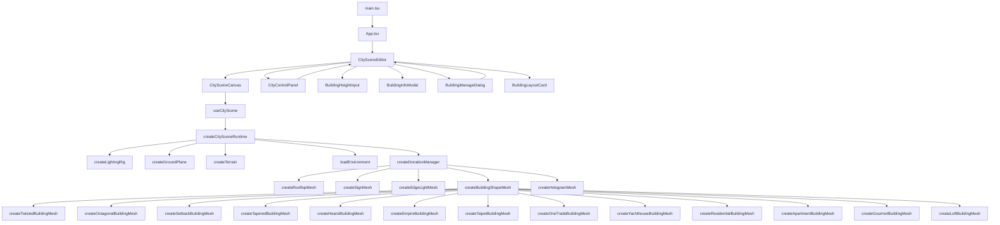
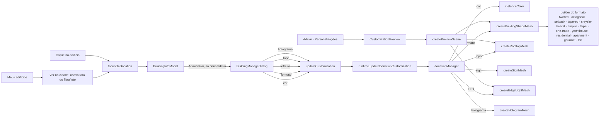

# Cidoe — Documentação

Cidoe é uma cena 3D de cidade procedural feita com `React 19`, `Three.js`, `TypeScript` e `Vite`. Gera prédios baseados em doações, com texturas PBR, iluminação configurável e sistema de sombras — tudo controlável via painel em tempo real.

> [!abstract] Para quem é essa documentação?
> O objetivo é ajudar um dev júnior a entender por onde a aplicação começa, onde cada responsabilidade fica, em qual arquivo mexer e como os dados saem do React e chegam na cena 3D.

> [!important] Estilo de escrita
> Toda escrita aqui = modo homem das cavernas. Corta artigo, enchimento, hedge. Fragmento OK. Termo técnico exato. Code block, wikilink, Mermaid ficam intactos.

## Pré-lançamento

Cadastro, login, perfil da conta e indicações continuam reais, conectados ao backend. Cidade funciona como simulação individual no navegador. Nenhuma configuração de ambiente habilita pagamentos reais nesta branch.

Recompensa por indicação também real: etapas contam cadastros indicados, sem contribuição; usuário escolhe item no `RewardDialog` → [[primeiros-inscritos]]. Indicação no passe exige contribuição real — aqui não avança.

### Dados da cidade

- Cenário inicial: leitura pública de `/donation/snapshot` e `/donation/customizations`.
- Snapshot sem doação → `createSeedBuildings(ongs)` (`src/lib/prelaunchCity.ts`) põe 480 edifícios fixos, só no front, pra cidade abrir cheia (grade 3×3 de quadras). Valor em cauda longa `5 + 595·(1 − i/480)³`: poucas torres, muita base. IDs `-1_000_000 - i` (longe dos locais `-1…-3`), 8 capitais, ONGs do catálogo em rodízio. Sem dono, sem perfil, nada no backend. Primeira doação pública real → seeds somem.
- Aparência dos seeds: `createSeedCustomizations(seeds)` entra em `savedCustomizations`. Determinística por índice. 40 maiores giram pelos 12 formatos; resto 1 a cada 4 entre 10 formatos de base; ~146 meshes próprios, demais instanciados. Cor só em 20 (1 a cada 24): 10 tons escuros e dessaturados (grafite, ardósia, café, bronze, musgo; canal ≤ `0x50`). Seed sem nada especial fica fora do mapa → cor global da cena; com acessório mas sem cor → `#d4d4d4` (= `DEFAULT_BUILDING_SETTINGS.color`). Acessório raro: heliponto/helicóptero/holofotes só nas 40 maiores, jardim a cada 13, nada em pináculo; LED só em 4 torres das 40 maiores, nunca em prédio baixo; letreiro "Cidoe" no central + nome da capital em ~12. Textura `null` → sorteio por edifício da cena. `seeded` (de `useDonations`) soma `SEED_FACADE_TEXTURES` (6 mais leves do repo, ~11 MB em segundo plano) ao pool do catálogo, que hoje tem 1 ativa. Admin edita cópia local por cima.
- Criar/aumentar: `simulateContribution(userId, contribution, city)` em `src/lib/prelaunchCity.ts`. Sem Pix, cobrança, polling ou gravação no banco.
- Máximo 3 edifícios por conta/navegador; mínimo R$ 5; valores somados em centavos.
- IDs negativos exclusivos da simulação; IDs públicos positivos preservados.
- Chaves: `cidoa:prelaunch:v1:<userId>:<area>`. Áreas `buildings`, `customizations`, `profiles` e `scene:<setting>`. Visitante usa `guest` somente para preferências.
- `LocalBuilding` inclui cidade (`id`, nome, UF) para restaurar filtros e localização mesmo se ausente do snapshot.
- `useLocalCityValue` usa `useSyncExternalStore`, eventos locais e `storage`: atualiza componentes e outras abas da mesma conta/navegador. Logout/troca de conta remove os edifícios e edições da conta anterior do render.
- `useLocalSceneState`: iluminação, terreno, texturas, ambiente/noite, reflexos, horizonte, layout, visibilidade, granulado, limite de renderização e filtros. Restaura valores por conta; não publica alterações.
- Personalização: debounce 500 ms por edifício; payload captura a conta que editou. Flush no unmount e `pagehide`. Nome/descrição/imagem salvam pelo formulário.
- Armazenamento bloqueado/cheio: erro visível, sem confirmar pagamento nem apagar valores anteriores. JSON inválido preservado, erro exibido.

### Interface

**Pré-lançamento** no título e no HUD público. **Simular contribuição → Confirmar pagamento simulado → Ver meu edifício**. Valores apresentados como simulados; nenhum dinheiro enviado à ONG.

Botão, painel e atalho `Ctrl+M` das configurações da cena exclusivos de `isAdmin` da sessão da cena. Card de layout e log de câmera também exclusivos de admin. Geradores manuais temporários do canvas deixam de ser montados; criação pública passa pelo fluxo local persistido. Administração do edifício continua disponível para dono local ou admin; admin altera apenas sua cópia no navegador.

### Limites

Limpar dados do site remove a cidade simulada; outro navegador/dispositivo não recebe esses dados. Não existe migração automática para edifícios reais. Backend e suas rotas administrativas continuam existentes; este frontend remove o caminho público de pagamento e escrita da cidade, sem mudar administração do backend.

### Verificação

`npm run build`, `npm run lint`, `node scripts/check-prelaunch.mjs`, `node scripts/check-contribution.mjs`, `node scripts/check-building-management.mjs`, `node scripts/check-donation-info.mjs`. Sem servidor ou navegador.

## Como a Documentação Está Organizada

Produção: [Docker e GHCR](../prod/README.md) — build local com Bun, imagens por branch, Compose sem build e proxy `/api`.

Domínio: `https://cidoe.com.br`, marca **Cidoe** (requisitos do Google em [[termos-e-privacidade#Página inicial — requisitos do Google]]). `cidoa.com.br` sem uso. Nomes internos seguem `cidoa`: repo, banco, imagem Docker, chaves `cidoa:*` do navegador e cache `cidoa-env-v2` — renomear chave apaga cidade e consentimento salvos.

As páginas ficam em pastas que **espelham as pastas do código** — assim você acha o doc pelo mesmo caminho do arquivo.

| Pasta da doc       | Espelha          | O que documenta                                            |
| ------------------ | ---------------- | ---------------------------------------------------------- |
| `components/`      | `src/components` | Interface React: painel de controle e canvas               |
| `scene/engine/`    | `src/scene`      | Maquinaria que monta e roda a cena (runtime, hooks, managers, builders) |
| `scene/foundation/`| `src/scene`      | Base que o engine consome: config, tipos e utils           |
| `admin/`           | `src/components` · `src/pages/admin` | Área admin (fora da cena): UI HTML/shadcn, roteamento, login e dashboard |
| `passe/`           | transversal      | Gamificação: liberação de personalização por doação + indicação |
| `desingn-system/`  | `src/index.css` · `src/components/ui` | Sistema de design: cor, tipo, borda em pixel, componentes, HUD |
| `legal/`           | `src/pages/legal` · `src/lib/legal.ts` | Termos de Uso, Política de Privacidade, aceite no cadastro e aviso de cookies |

> [!tip] Adicionando uma página nova
> 1. Crie o `.md` dentro da pasta cujo **tema** combina (componente novo → `components/`; peça nova da cena → `scene/engine/`; tipo/config novo → `scene/foundation/`).
> 2. Linke com wikilink pelo **nome do arquivo**, ex.: `[[scene-runtime]]` — funciona de qualquer pasta, não use o caminho.
> 3. Registre a página aqui no `index.md` (árvore de arquivos + tabela "Onde Mexer?").

## Visão Geral Rápida

O projeto é dividido em 3 grandes partes:

| Pasta            | Responsabilidade                                                       |
| ---------------- | ---------------------------------------------------------------------- |
| `src/components` | Interface React — editor, painel lateral e canvas                      |
| `src/scene`      | Lógica 3D — tipos, configs, utils, builders, managers, hooks e runtime |
| `doc`    | Documentação da estrutura                                              |

## Estrutura de Arquivos

```text
scripts/
  ui-add.sh                    ← adiciona primitivo shadcn corrigindo o CLI (`bun run ui:add <nome>`)
  encode-webp.mjs              ← texturas PBR + HDRI → `.webp` (1K), `.low.webp` (512, mobile), `.pmrem.webp` (`npm run textures:webp`)
  encode-ktx2.mjs              ← converte texturas PBR pra KTX2 (`npm run textures:ktx2`); superado pelo WebP
  check-pass.mjs               ← ordenação do passe sem servidor/navegador
  check-reward-notifications.mjs ← requests, sessão, respostas atrasadas e confirmação dos avisos; sem servidor/navegador
  check-reward-examples.mjs    ← exemplos admin: conquista, escolha de dois itens e confirmação local; sem API/navegador
  check-signup-reward-dialog.mjs ← escolha/conquista, confete, prévia 3D, teclado e descarte; sem navegador/GPU
  check-admin-ongs.mjs         ← cadastro/edição de ONG, foto, status e erros, sem servidor/navegador
  check-consent.mjs            ← aceite no cadastro + aviso de cookies, sem servidor/navegador
  check-analytics.mjs          ← Consent Mode, aceite/recusa, revogação e tag única; sem servidor/navegador
  check-city-search.mjs        ← busca de cidade (acento, prefixo antes de substring, UF, limite) sem navegador
  check-contribution.mjs       ← máscara monetária + confirmação da simulação local; sem servidor/navegador
  check-building-management.mjs ← administração, posse, descarte e foco após filtro/pagamento; sem servidor/navegador
  check-donation-info.mjs      ← foto, totais, 5 ONGs em linhas, filtros e transição cena/seção; sem servidor/navegador
  check-building-shapes.mjs    ← checa os 15 formatos + o preview do admin sem navegador (`node scripts/check-building-shapes.mjs`)
  check-building-draw-calls.mjs ← grupos por material, triângulos, picking, cache, transparência e dispose; sem navegador/GPU → [[scene-builders#Agrupamento por material (mobile)]]
  render-building.mjs          ← PNG headless de um formato com a luz da cidade: 4 vistas + referência (`node scripts/render-building.mjs <formato>`) → [[novo-edificio]]
  check-building-textures.mjs  ← troca de textura no destaque padrão; reuso de meshes/cache, sem navegador
  check-horizon.mjs            ← horizonte, montanhas e culling no runtime sem servidor/navegador/GPU
public/
  basis/                       ← transcoder basis do KTX2Loader (js + wasm)
  fonts/                       ← Manrope + JetBrains Mono self-hosted (woff2 latin/latin-ext) → [[desingn-system-index]]
  favicon-32.png               ← logo oficial verde-oliva 32px (aba do navegador)
  logo.webp                    ← logo oficial verde-oliva 192px: placa da marca + hero da home → [[html-components]]
  logo-branca.webp             ← logo oficial branca 192px: `CidoeLogo` no tema escuro (admin)
  og-image.jpg                 ← `Cidoe.png` em 1200×630; prévia de link (`og:image` absoluto em `index.html`)
  logo-{branca,preta,verde-oliva}.png, Cidoe.png ← originais da marca (1254px / 1733×908), fonte dos derivados
  robots.txt                   ← libera tudo; sem ele nginx devolvia `index.html`
  video-cidoe.mp4              ← vídeo de apresentação 1080×1920, 15 s → [[html-components#IntroVideoDialog.tsx]]
src/
  App.tsx
  main.tsx                      ← entry; restaura consentimento do Analytics; reload em `vite:preloadError` (chunk de deploy antigo)
  index.css                     ← tokens do DS + utilitários (`pixel`, `bevel-*`, `field`, `menu-cursor`…) + controles nativos → [[desingn-system-index]]
  api/
    http.ts
    admin/
      admin.routes.ts             ← sessão do painel (login senha/me/logout) + usuários + rotas /admin
    auth/
      auth.routes.ts              ← sessão da cena: login e cadastro passwordless/Google
      auth.types.ts               ← contratos do perfil + desafio por código
    referral/
      referral.routes.ts          ← preview, resumo e confirmação de indicação
      referral.types.ts           ← contratos do sistema de indicação
      referral.logic.ts           ← normalização e decisão do modal
    user/
      user.routes.ts              ← perfil próprio + `completeOnboarding` (sessão da cena)
      user.types.ts               ← usuário público (imagem base64, cidade, origem, onboarding)
    location/
      location.routes.ts          ← `getCities()`: catálogo IBGE, 1 requisição memoizada por carga
      location.types.ts           ← `City { id, name, uf }`
    customizationApi.ts             ← catálogo de personalizações + conquistas do usuário
    donationApi.ts                  ← snapshot + personalizações atuais + edifícios próprios completos + PUT da personalização
    contributionApi.ts              ← leitura de perfil público + edição local no pré-lançamento
    regions.ts
  pages/legal/
    LegalPage.tsx               ← layout público dos documentos: versão, índice de seções, texto em placa
    Terms.tsx                   ← /termos
    Privacy.tsx                 ← /privacidade
  pages/admin/
    Ongs.tsx                    ← /dale/ongs: criar, editar nome/foto, ativar/desativar, excluir
    Pass.tsx                    ← página dedicada /dale/passe
    Users.tsx                   ← /dale/usuarios: busca conta, menu ⋮ (admin/excluir), paginação
  components/
    pass/
      PassTrack.tsx             ← trilha/grade reutilizável, um cartão por recompensa
      RewardDialog.tsx          ← conquista em cartões, confete e prévia 3D; delega escolha por indicação → [[passe-front]]
      SignupRewardDialog.tsx    ← escolha por indicação: revelação dos itens + prévia 3D interativa sob demanda
      RewardConfetti.tsx        ← celebração Canvas por abertura, carregamento lazy, paleta do DS e limpeza
    customization/
      CustomizationImage.tsx    ← miniatura compartilhada com catálogo
      BuildingCustomizer.tsx   ← menu reutilizável por categorias, grade e prévia 3D; lazy na administração do edifício
    admin/
      UnlockDialog.tsx          ← editor de requisitos compartilhado
      RewardExamples.tsx        ← exemplos locais dos dois modais reais, no Passe e nas recompensas por indicação
    ui/
      pixel-icon.tsx                ← ícones em pixel do DS, logo, gato/cachorro, `BlockLoader`, `PixelPhoto`
      photo.tsx                     ← `<Photo ratio>`: foto na moldura do DS, espera em blocos, "Foto indisponível"
      avatar.tsx                    ← avatar quadrado do DS: 32/48/72, iniciais mono
      block-bar.tsx                 ← barra de progresso em blocos (DS)
      badge.tsx                     ← Badge shadcn; requisito de liberação no admin
      switch.tsx                    ← Switch shadcn usado nas ativações do admin
      pagination.tsx                ← Pagination shadcn; botão no lugar de <a> (página é estado, não URL)
      select.tsx                    ← Select shadcn; filtro de personalização no admin
      toast.tsx                     ← notificações: toast.* + <Toaster /> (Radix Toast), cena e admin
    AuthMenu.tsx                  ← Entrar, Meus edifícios e menu do usuário na cena; fluxo de indicação; monta o onboarding
    OnboardingDialog.tsx          ← 1º login: cidade + como conheceu, opcional, uma vez por conta, "Pular"
    ProfileDetailsFields.tsx      ← campos compartilhados onboarding/Perfil: busca de cidade + chips de origem
    GameMenu.tsx                  ← menu estilo GTA: abas perfil/edifícios/personalizações/indicações, dia/noite, sair
    AuthDialog.tsx                ← login por e-mail ou Google; cadastro confirma nome + username + aceite dos termos. `AuthPanel` = corpo reusável
    IntroVideoDialog.tsx          ← vídeo de apresentação do 1º acesso (mudo, loop, sem controles); mobile + "Entrar", desktop + login à direita
    TermsConsent.tsx              ← caixa de aceite somente no cadastro, sem declaração de idade
    CookieNotice.tsx              ← aviso de cookies: Recusar / Aceitar (GA só após aceite)
    AuthProvider.tsx              ← sessão da cena (cookie token_access), só na rota /
    AdminAuthProvider.tsx         ← sessão do painel (cookie token_admin), só em /dale/*
    RequireAdmin.tsx              ← guarda de /dale: exige sessão do painel
    ProfilePanel.tsx              ← aba Perfil do GameMenu: nome, username, imagem, cidade e como conheceu
    referral/
      ReferralDialog.tsx          ← confirmação e avisos da indicação
      ReferralPerson.tsx          ← nome e imagem do indicador
      ShareDialog.tsx             ← `SharePanel` (redes + copiar link, inline no menu) + `ShareDialog` (modal da home)
    CitySceneEditor.tsx
    html/
      CityControlPanel.tsx
      BuildingHeightInput.tsx
      BuildingLayoutCard.tsx       ← card flutuante: modo de layout + teto de edifícios na tela
      DonationLoadOverlay.tsx      ← card de carregamento; `cover` = página de loading inicial (sem imagem, sai com tudo carregado) → [[html-components#Carregamento inicial (casca)]]
      DonationFilterBar.tsx
      DonationInfoSection.tsx     ← home: hero, 01 Impacto, 02 até 6 cartões de ONG, rodapé; fundo `pattern-paws` (DS)
      BuildingInfoModal.tsx          ← card só-leitura do prédio clicado; lápis só p/ dono/admin
      donate/
        ContributeDialog.tsx         ← simulação → pagamento simulado → confirmação local; sem edição
        BuildingProfileForm.tsx      ← imagem/nome/descrição do edifício + dialog de edição
      BuildingManageDialog.tsx   ← administração independente: informações + aparência/prévia 3D
      BuildingControls.tsx
      TextureControls.tsx
      ReflectionControls.tsx         ← aba reflexo: probe do envMap dos prédios
      GroundControls.tsx
      HorizonControls.tsx          ← modos do final do chão, distâncias e névoa
      TerrainControls.tsx
      SceneLightControls.tsx
      EnvironmentControls.tsx
      PointLightControls.tsx
  lib/
    analytics.ts                   ← GA4 G-GEHP0ENSCR: produção, Consent Mode básico v2, tag após aceite, revogação
    rewardNotifications.ts         ← motivo histórico + próxima conquista na ordem do passe
    legal.ts                       ← versão dos termos, controlador, e-mail de contato, rotas legais
    googleIdentity.ts              ← `loadGoogleIdentity()`: GSI sob demanda (abre login), promise única
    image.ts                       ← valida e reduz imagens proporcionalmente para até 400 px
    citySearch.ts                  ← busca de cidade pura: sem acento, prefixo antes de substring
    moneyInput.ts                  ← máscara monetária da contribuição: vírgula/2 casas sempre, milhar e colagem em reais
    pass.ts                        ← contrato visual e ordenação por esforço estimado
    adminUnlock.ts                 ← alvos de edição por opção/feature
    unlock.ts                      ← fonte única: requisito do passe → texto (badge, frase, o que falta)
    pagination.ts                  ← janela de páginas da barra de paginação (1, atual ± 1, última)
      PanelIntro.tsx
      KeyboardShortcutsHelp.tsx
      controls/
        PanelSection.tsx
        ColorField.tsx
        RangeField.tsx
        NumberField.tsx
        CheckboxField.tsx
        PointLightCard.tsx
    hooks/
      useKeyboardShortcuts.ts
      useDonations.ts
      useCustomizationCatalog.ts   ← catálogo 1×, conquistas atualizadas após pagamento
      useOwnedDonationIds.ts       ← edifícios locais da conta (posse e lista sem API de doações próprias)
    three/
      CitySceneCanvas.tsx
      CustomizationPreview.tsx     ← miniatura + preview 3D de formato/topo/LED (admin)
      BuildingPreview.tsx          ← edifício completo no modal, renderer só enquanto aberto
  scene/
    types.ts
    config/
      citySceneConfig.ts
      buildingConfig.ts
      textureConfig.ts
      groundConfig.ts
      horizonConfig.ts             ← linha reta por padrão
      terrainConfig.ts
      lightConfig.ts
      environmentConfig.ts
      reflectionConfig.ts
      blockLayoutConfig.ts
      uiVisibilityConfig.ts
    builders/
      createLightingRig.ts
      createGroundPlane.ts
      createTerrain.ts
      createRooftopMesh.ts
      createParapetMesh.ts         ← platibandas automáticas, 3 modelos instanciados
      createSignMesh.ts
      createEdgeLightMesh.ts
      createBuildingShapeMesh.ts   ← registro formato → builder + agrupamento por material (cena + admin; ordem original no foco transparente)
      createPreviewScene.ts        ← cena isolada de personalização/admin ou edifício completo/modal
      createTwistedBuildingMesh.ts
      createOctagonalBuildingMesh.ts
      createSetbackBuildingMesh.ts
      createTaperedBuildingMesh.ts
      createHearstBuildingMesh.ts
      createEmpireBuildingMesh.ts
      createTaipeiBuildingMesh.ts
      createOneTradeBuildingMesh.ts
      createYachthouseBuildingMesh.ts ← Yatchcasa: torres gêmeas de vidro azul-escuro, linhas douradas, embasamento bege
      createResidentialBuildingMesh.ts ← torre residencial com sacadas, vidro refletindo a cena
      createApartmentBuildingMesh.ts ← torre de reboco branco, janelas em grade, rasgo de sacadas
      createGourmetBuildingMesh.ts ← Varanda Gourmet: torre bege e creme, sacadas curvas, pilastras com rasgo
      createLoftBuildingMesh.ts    ← Loftifício: torre bege, faixas de pastilha verde, pilotis, portões
      createHologramMesh.ts
      loadEnvironment.ts
    managers/
      createDonationManager.ts
      createChunkManager.ts   ← referência arquitetural
    textures/
      facadeTextureManifest.ts  ← descobre pastas de textura (glob, sem THREE). `.low.webp` (mobile) > `.webp` > PNG/JPG > KTX2
      facadeTextureLoader.ts    ← carrega set PBR (lazy + async + cache)
      loadImageTexture.ts       ← ImageBitmap (decode fora da main thread) com fallback TextureLoader
    hooks/
      useCityScene.ts
    runtime/
      createScenePreparer.ts      ← cache de variantes e uploads incrementais
      createCitySceneRuntime.ts
    utils/
      math.ts
      materials.ts
      lighting.ts
      random.ts
      instanceCulling.ts
      devAssertions.ts
      deviceTier.ts              ← `IS_LOW_TIER`: toque ou ≤4 núcleos/GB → cena leve, texturas 512
doc/
  index.md                       ← você está aqui (mapa da documentação)
  api/                           ← espelha src/api (camada de dados / doações)
    donation-api.md
    referral.md                  ← links, código, confirmação e compartilhamento
    customization-api.md         ← catálogo, conquistas do usuário, formatação do requisito
    contribution-api.md          ← simulação local + leitura/edição de perfil do edifício
  components/                    ← espelha src/components (interface React)
    html-components.md
    three-components.md
  scene/                         ← espelha src/scene (lógica 3D)
    engine/                      ← maquinaria que monta e roda a cena
      scene-runtime.md
      scene-hooks.md
      scene-managers.md
      scene-builders.md
      novo-edificio.md           ← guia: criar/editar modelo de edifício, render de avaliação, limpeza
      scene-textures.md          ← texturas: manifesto, loader lazy/async/cache, pipeline WebP/KTX2, por-edifício
    foundation/                  ← base de dados consumida pelo engine
      scene-config.md
      scene-types.md
      scene-utils.md
  desingn-system/                ← regra visual de toda UI HTML (cena + /dale)
    desingn-system-index.md      ← cor, tipografia, assinatura de jogo, imagem, componentes, HUD, composição de página, desvios, proibido
    Cidoe Design System.html     ← fonte original do DS (bundle; abre no navegador)
  passe/                         ← gamificação (transversal: api + lib + admin + cena)
    passe-front.md               ← índice do módulo: contrato, estado, mapa
    passe-formatacao.md          ← src/lib/unlock.ts — requisito vira texto (fonte única)
    passe-admin-ui.md            ← tela onde admin define quanto custa cada personalização
    passe-cena.md                ← cadeado no painel do usuário (fase seguinte)
  admin/                         ← área admin do front (fora da cena 3D)
    componentes-html.md          ← base de UI: shadcn, tema, roteamento, componentes
    area-admin.md                ← login, dashboard, auth e API admin
    edificios-teste.md           ← gerar/excluir edifícios fictícios em massa
    personalizacoes.md           ← CRUD do catálogo de personalizações
    ibge.md                      ← vincular catálogo geográfico do IBGE
    usuarios.md                  ← listar contas, dar/tirar admin, excluir usuário; o que admin ganha
    ongs.md                      ← cadastro, foto, ativação e exclusão de ONGs
```

## Fluxo da Aplicação

### 1. Entrada

- `src/main.tsx` → renderiza React no `#root`
- `src/App.tsx` → `BrowserRouter` com rotas lazy: `/` = `CitySceneEditor` (cena) dentro de `AuthProvider`; `/dale/login` + `/dale` = área admin dentro de `AdminAuthProvider` (layout route) + `RequireAdmin` (ver [[componentes-html#Roteamento]] e [[area-admin]]). Cada área monta só a própria sessão — login numa não abre a outra ([[area-admin#Duas sessões (cena × painel)]]). `<Toaster />` global montado aqui — ver [[componentes-html#Notificações (toast)]]
- `/termos` e `/privacidade` → documentos legais públicos, fora de qualquer provider de sessão ([[termos-e-privacidade]]).
- Acesso público na cena → `AuthDialog`: e-mail → código, ou Google. Conta existente entra; conta nova confirma `name` + `username` (Google já sugere ambos) com o e-mail bloqueado na tela e marca a caixa de aceite dos termos. Login de conta existente não solicita novo aceite. O aviso de cookies é independente do cadastro e não bloqueia a navegação. Campo de indicação fica no rodapé do modal, escondido atrás de link sublinhado; `?ref=` já abre preenchido com preview. Ver [[area-admin#Login público na cena (passwordless)]] e [[referral]].

### 2. Container Principal

`src/components/CitySceneEditor.tsx` é o componente mais importante do lado React.

Ele guarda todos os estados:

- `buildingSettings`, `textureSettings`, `groundSettings`
- `lightSettings`
- `environmentSettings`, `reflectionSettings`, `horizonSettings`, `blockLayoutSettings`, `terrainSettings`
- `sceneStats`, `hoverInfo`
- `showControlPanel` — toggle do painel de configuração (escondido por padrão)
- `infoBuildingId` — edifício clicado; abre [[html-components#BuildingInfoModal.tsx|BuildingInfoModal]]
- `selectedBuildingId` — edifício em administração; diálogo só renderiza se `canEdit` (dono ou admin, ver [[donation-api#Quem pode editar]])
- `buildingCustomizations` — `Map<donationId, BuildingCustomization>` com cor, formato (default/twisted/octagonal/setback/tapered/chrysler/hearst/empire/taipei/one-trade/yachthouse/residential/apartment/gourmet/loft), acessório de topo (holofotes, heliponto, jardim suspenso ou helicóptero com casco único, vidros integrados e rotores proporcionais), letreiro, LED de arestas e holograma cyberpunk. **Persistido**: nasce do snapshot, cada mudança grava em `donation.customization` no banco — ver [[donation-api#Personalização persistida]]
- Falha da gravação (sem login, prédio de outro, opção travada) → toast por edifício, ver [[donation-api#Personalização persistida]]

E entrega para:

- [[three-components|CitySceneCanvas]] — monta a cena 3D
- [[html-components|CityControlPanel]] — mostra os controles (abre pelo ícone de engrenagem, que some quando o painel está aberto; fecha pelo "X" na barra de abas)
- [[html-components#BuildingManageDialog.tsx|BuildingManageDialog]] — informações e aparência do edifício selecionado, independente do pagamento. Abre pelo card → Administrar; dono/admin.
- [[html-components#BuildingCustomizer.tsx|BuildingCustomizer]] — grade por categoria e prévia 3D na aba Aparência da administração. `selectedCustomization` memoizado; `updateCustomization` compartilha estado e salvamento com a cidade. Menu/canvas montam somente na aba ativa.
- [[html-components#BuildingHeightInput.tsx|BuildingHeightInput]] — input de doação e layout
- [[html-components#BuildingLayoutCard.tsx|BuildingLayoutCard]] — card flutuante: modo de layout + quantos edifícios entram na cena

Também gerencia:

- Doações do backend via `useDonations` (snapshot cacheado + personalizações `no-store`) → `canvasRef.setDonations(donations)` quando `loadState.status === "ready"`. Ver [[donation-api]]
- Meus edifícios: lista própria sem filtro, Ver na cidade revela/foca e abre informações; Administrar edita sem criar cobrança. Foco pendente aguarda edifício no rebuild; trocar conta/fechar card cancela. Rebuild mantém administração se edifício continua visível.
- Contribuição no pré-lançamento: máximo 3 edifícios locais por conta/navegador, mínimo R$ 5; aumento mantém cidade e acumula ONGs. Confirmação grava somente localStorage; nunca cria cobrança ou edifício no banco. Ver [[contribution-api]].
- Teto de edifícios na cena (`visibleLimit`, padrão `null` = todos): ordena por valor desc e corta antes do `setDonations`, então o corte fica com as maiores doações. Controlado pelo [[html-components#BuildingLayoutCard.tsx|BuildingLayoutCard]]
- Doações manuais via `canvasRef.addDonation(value)` e `canvasRef.addDonations(values)`
- Foco em edifício via `canvasRef.focusOnDonation(id)` e `canvasRef.clearFocus()`
- Personalização via `canvasRef.updateDonationCustomization(id, customization)`

### 3. Canvas 3D

[[three-components|CitySceneCanvas.tsx]] cria um `div` com `ref` e chama o hook [[scene-hooks|useCityScene]], que monta o renderer Three.js dentro do div.

### 4. Painel Lateral

[[html-components|CityControlPanel.tsx]] organiza os componentes do painel em abas. Não conhece Three.js — só atualiza estado React.

### 5. Hook da Cena

[[scene-hooks|useCityScene.ts]] conecta React com Three.js. Cria o runtime uma vez, depois sincroniza mudanças de estado chamando métodos do runtime.

### 6. Runtime da Cena

[[scene-runtime|createCitySceneRuntime.ts]] é o cérebro do Three.js. Orquestra scene, camera, renderer, controls, builders e managers.

Aba **Horizonte** → **Final do chão**: **Linha reta** (padrão), **Circular** ou **Quadrado (original)**. `groundEdgeMode` escolhe formato; `groundDistance` (20–2200, padrão 660) define distância à frente, raio ou meio lado. Reta acompanha direção da câmera e dimensiona laterais pelo frustum completo, evitando quinas mesmo em ultrawide ou distância curta. Névoa suaviza transição. `renderDistance` continua controlando câmera/céu; edifícios preservam controle próprio. Montanhas e chão da cidade (lotes, calçadas, postes, asfalto) seguem o horizonte (1.8·`far`), não o slider dos edifícios: raio menor desenha arco dentro da imagem e o chão parece encolher quando a câmera mexe. Pesquisa e limites em [[scene-builders#createGroundPlane.ts]]; integração em [[scene-runtime#Alcance visual e distância dos edifícios]].

## Diagrama de Fluxo



## Fluxo de Personalização de Edifícios



## Onde Mexer?

| Objetivo                                         | Arquivo                                           |
| ------------------------------------------------ | ------------------------------------------------- |
| Alterar valor padrão dos prédios                 | [[scene-config]]                                  |
| Cor, fonte, borda em pixel, bisel, estilo de botão/campo | [[desingn-system-index]] · tokens em `src/index.css` · primitivos em `src/components/ui/` |
| Página fora da cena (fundo de pegadas, cabeçalho numerado, ritmo) | [[desingn-system-index#Composição de página]] |
| Foto, avatar, logo (proporção, moldura, carregando/erro, direção de foto) | [[desingn-system-index#Imagem]] · `src/components/ui/photo.tsx` · `src/components/ui/avatar.tsx` |
| App diverge do arquivo do DS (tamanho, mascote, dado faltando) | [[desingn-system-index#Desvios conscientes]] |
| Alterar a UI do painel de configuração           | [[html-components#CityControlPanel.tsx]]          |
| Granulado de render sob carga (padrão `0`)       | aba **tela** em [[html-components#CityControlPanel.tsx]] · `setGrain` em [[scene-runtime#Granulado (setGrain)]] |
| Menu do usuário (abas, perfil, edifícios, sair)    | [[html-components#GameMenu.tsx]]                  |
| Vídeo de apresentação do 1º acesso               | [[html-components#IntroVideoDialog.tsx]]          |
| Modo noite: toggle no menu do usuário            | [[area-admin#Modo noite (menu do usuário)]]       |
| Modo noite: céu escuro e estrelas                | [[scene-builders#loadEnvironment.ts]]             |
| Modo noite: luz, IBL e névoa                     | [[scene-runtime#Modo noite]] · `NIGHT_PRESET` em [[scene-config#environmentConfig.ts]] |
| Modo noite: janelas acesas na fachada            | [[scene-managers#Janelas acesas de noite]]        |
| Modo noite: brilho das janelas (slider)          | seção **Ambiente** → [[html-components#EnvironmentControls.tsx]] |
| Postes de luz nas ruas (quantidade, altura, luz) | [[scene-managers#Postes de Luz (rebuildStreetLamps)]] |
| Adicionar/alterar atalho de teclado              | [[html-components#Atalhos de teclado]]            |
| Mostrar/esconder componentes HTML da tela        | aba **Tela** → [[scene-config#uiVisibilityConfig.ts]] |
| Trocar modo de layout (quadra × centro)          | [[html-components#BuildingLayoutCard.tsx]]        |
| Limitar quantos edifícios aparecem na tela       | [[html-components#BuildingLayoutCard.tsx]] · `visibleLimit` no `CitySceneEditor` |
| Visualizar/administrar edifícios próprios       | [[html-components#BuildingManageDialog.tsx]]    |
| Botão Contribuir / fluxo de contribuição         | [[html-components#ContributeDialog.tsx]]          |
| Busca de ONG / campo de valor / resumo da simulação     | [[html-components#ContributeDialog.tsx]] · `src/lib/moneyInput.ts` · `scripts/check-contribution.mjs` |
| Pagamento simulado / persistência local | [[contribution-api]]                            |
| Edifício do usuário aparecer no login            | [[donation-api#Edifícios do usuário no login]]    |
| Imagem, nome e descrição do edifício             | [[html-components#BuildingProfileForm.tsx]]       |
| Card de info do prédio / quem pode editar        | [[html-components#BuildingInfoModal.tsx]] · [[donation-api#Quem pode editar]] |
| Personalização salvar/carregar do banco          | [[donation-api#Personalização persistida]]        |
| Entender de onde vêm as opções de personalização | [[customization-api]]                             |
| Cadastrar/ativar cores e opções (admin)          | [[personalizacoes]]                               |
| Entender a gamificação inteira                   | [[passe-front]]                                   |
| Definir quanto doar/indicar pra liberar (admin)  | [[passe-admin-ui#Dialog de liberação]]            |
| Ver a curva inteira de conquistas (admin)        | [[passe-admin-ui#Visão Passe]]                    |
| Abrir exemplos dos modais de conquista e escolha (admin) | [[passe-admin-ui#Exemplos de notificações]] · [[primeiros-inscritos]] |
| Reutilizar a trilha visual para usuários         | [[html-components#PassTrack.tsx]]                |
| Mudar o texto do requisito ("R$ 50 + 3 indicações") | [[passe-formatacao]]                           |
| Colocar cadeado na cena / painel do usuário      | [[passe-cena]]                                    |
| Trocar textura da fachada (UI) / entender loading | [[scene-textures]] · aba **texturas** → [[html-components#TextureControls.tsx]] |
| Cadastrar textura nova (dropar pasta + `npm run textures:webp` + admin) | [[scene-textures#Pipeline WebP]] · [[personalizacoes]] |
| Textura por edifício (usuário escolhe a dele)    | [[scene-textures#Por edifício]] · [[html-components#BuildingManageDialog.tsx]] |
| Textura sorteada por edifício (cidade variada)   | [[scene-textures#Sorteio por edifício]] · [[scene-managers#Grupos de fachada]] |
| Mexer no pipeline WebP (qualidade, variante 512 mobile, HDRI) | [[scene-textures#Pipeline WebP]] · `scripts/encode-webp.mjs` |
| Mexer no pipeline KTX2 (codec, tamanho, qualidade) | [[scene-textures#Pipeline KTX2 (fallback, fora do caminho padrão)]] · `scripts/encode-ktx2.mjs` |
| Página de loading / velocidade da home (PageSpeed): loading no HTML, fontes, GSI sob demanda, cache nginx | [[html-components#Carregamento inicial (casca)]] · `index.html` · `docker/nginx.conf` |
| Modo leve mobile (`IS_LOW_TIER`: texturas 512, céu 2K, DPR/FPS) | `src/scene/utils/deviceTier.ts` · [[scene-textures]] · [[scene-runtime]] |
| Alterar o canvas ou a ligação com o hook         | [[three-components]]                              |
| Alterar fórmulas de luz, clamp ou material       | [[scene-utils]]                                   |
| Mexer no cull de distância do chão (quadra, calçada, poste, asfalto) | [[scene-utils#`instanceCulling.ts`]] · [[scene-managers#Cull do chão da cidade]] |
| Mexer no cull de distância das montanhas         | [[scene-builders#createTerrain.ts]]               |
| Alterar criação do chão, grid, luzes ou ambiente | [[scene-builders]]                                |
| Alterar o relevo procedural (terreno verde)      | [[scene-builders#createTerrain.ts]]               |
| Alterar valores padrão do relevo                 | [[scene-config#terrainConfig.ts]]                 |
| Alterar a UI dos controles de relevo (aba **terreno**) | [[html-components#TerrainControls.tsx]]     |
| Alterar acessórios de topo                       | [[scene-builders#createRooftopMesh.ts]]           |
| Alterar platibandas automáticas                  | [[scene-builders#createParapetMesh.ts]]           |
| Alterar letreiros de fachada (signs)             | [[scene-builders#createSignMesh.ts]]              |
| Alterar LED de arestas                           | [[scene-builders#createEdgeLightMesh.ts]]         |
| Ajustar luz do LED nos vizinhos (intensidade, alcance, nº de luzes) | [[scene-managers#Fora do reflexo, dentro da luz]] |
| Alterar holograma cyberpunk                      | [[scene-builders#createHologramMesh.ts]]          |
| Adicionar formato de edifício novo               | [[scene-builders#createBuildingShapeMesh.ts]] + [[scene-types#BuildingShape]] |
| Ver formato/topo/LED em 3D no admin              | [[personalizacoes#Preview 3D: Formato, Topo e LED]] · [[three-components#CustomizationPreview.tsx]] |
| Dar preview 3D a outra categoria do catálogo     | `PREVIEW_KIND` em `src/lib/pass.ts` + [[scene-builders#createPreviewScene.ts]] |
| Alterar torre torcida (twisted)                  | [[scene-builders#createTwistedBuildingMesh.ts]]   |
| Alterar torre octogonal (octagonal)              | [[scene-builders#createOctagonalBuildingMesh.ts]] |
| Alterar torre setback (setback)                  | [[scene-builders#createSetbackBuildingMesh.ts]]   |
| Alterar torre afunilada (tapered)                | [[scene-builders#createTaperedBuildingMesh.ts]]   |
| Alterar torre Hearst (hearst)                    | [[scene-builders#createHearstBuildingMesh.ts]]    |
| Alterar torre Empire State (empire)              | [[scene-builders#createEmpireBuildingMesh.ts]]    |
| Alterar torre Taipei 101 (taipei)                | [[scene-builders#createTaipeiBuildingMesh.ts]]    |
| Alterar torres Yatchcasa (yachthouse)            | [[scene-builders#createYachthouseBuildingMesh.ts]] |
| Criar/editar modelo de edifício, avaliar visual, limpar ao fim | [[novo-edificio]] · `scripts/render-building.mjs` |
| Alterar torre residencial com sacadas (residential) | [[scene-builders#createResidentialBuildingMesh.ts]] |
| Alterar torre de reboco com janelas (apartment)  | [[scene-builders#createApartmentBuildingMesh.ts]] |
| Alterar torre Varanda Gourmet (gourmet)          | [[scene-builders#createGourmetBuildingMesh.ts]] |
| Alterar torre Loftifício (loft)                  | [[scene-builders#createLoftBuildingMesh.ts]]    |
| Alterar torre One Trade (one-trade)              | [[scene-builders#createOneTradeBuildingMesh.ts]]  |

| Alterar torre Chrysler (chrysler) | [[scene-builders#createChryslerBuildingMesh.ts]] |
| Carregar/buscar doações do backend | [[donation-api]] |
| Filtrar doações por região/UF/cidade/ONG | [[donation-api]] |
| Overlay de carregamento / barra de filtros | [[html-components]] |
| ONGs e contribuições abaixo da cena | [[html-components#DonationInfoSection.tsx]] |
| Alterar geração dos prédios de doação | [[scene-managers]] |
| Alterar loteamento / lotes vazios / asfalto | [[scene-managers#Loteamento e Lotes Vazios]] |
| Ajustar destaque da quadra central (escala/altura das torres, prédio do centro) | [[scene-managers#Destaque da Quadra Central]] |
| Alterar calçada / faixa central / cruzamentos | [[scene-managers#Rede de Estradas (Asfalto)]] |
| Alterar postes de luz das ruas | [[scene-managers#Postes de Luz (rebuildStreetLamps)]] |
| Trocar a cor das quadras (UI) | aba **geral** → seção Quadras → [[html-components#CityControlPanel.tsx]] |
| Trocar cor/altura da calçada (UI) | aba **geral** → seção Calçada → [[html-components#CityControlPanel.tsx]] |
| Alterar o ciclo completo da cena | [[scene-runtime]] |
| Ajustar reflexo dos prédios (probe do envMap) | [[scene-runtime#Probe de reflexo (envMap dos prédios)]] |
| Controlar reflexo pela UI (posição, qualidade, cadência) | aba **reflexo** → [[html-components#ReflectionControls.tsx]] |
| Mudar a direção do reflexo (reflexo só nas laterais) | aba **reflexo** → seção Direção do reflexo → [[scene-runtime#Probe de reflexo (envMap dos prédios)]] |
| Entender o contrato dos dados | [[scene-types]] |
| Entender como React sincroniza com Three.js | [[scene-hooks]] |
| Mexer na UI/tema/componentes do admin | [[componentes-html]] |
| Mexer no login, dashboard ou auth do admin | [[area-admin]] |
| Mexer no login do painel / sessão admin (`token_admin`) | [[area-admin#AdminAuthProvider]] · guarda em [[area-admin#RequireAdmin]] |
| Sessão da cena vs painel (cookies, providers, 401) | [[area-admin#Duas sessões (cena × painel)]] |
| Botão de login + modal passwordless na cena | [[area-admin#Login público na cena (passwordless)]] |
| Texto dos Termos de Uso / Política de Privacidade | `src/pages/legal/Terms.tsx` · `Privacy.tsx` → [[termos-e-privacidade]] |
| Mudar versão dos termos registrada no cadastro, controlador, e-mail de contato | `src/lib/legal.ts` → [[termos-e-privacidade#Mudar os termos]] |
| Caixa de aceite no cadastro / aviso de cookies | [[html-components#TermsConsent.tsx]] · [[html-components#CookieNotice.tsx]] · [[termos-e-privacidade#Aceite no cadastro]] |
| Google Analytics / consentimento / medição das rotas SPA | `src/lib/analytics.ts` · `src/main.tsx` → [[termos-e-privacidade#Google Analytics]] |
| Onboarding do 1º login (cidade, como conheceu, pular) | [[html-components#OnboardingDialog.tsx]] · [[area-admin#Perfil progressivo (onboarding)]] |
| Campo Cidade (busca) / chips "Como conheceu?" | [[html-components#ProfileDetailsFields.tsx]] · busca em `src/lib/citySearch.ts` |
| Rótulos das origens ("Instagram", "Uma ONG"…) | `DISCOVERY_LABELS` em [[html-components#ProfileDetailsFields.tsx]] |
| Gerenciar ONGs: nome, foto, status e exclusão | [[ongs]] |
| Gerar/excluir edifícios fictícios em massa (admin) | [[edificios-teste]] |
| Vincular catálogo do IBGE (regiões/estados/municípios) | [[ibge]] |
| Colocar um usuário como admin | [[usuarios]] |
| Excluir um usuário e todos os dados dele | [[usuarios#Excluir usuário]] |
| Entender o que admin libera (personalização sem cadeado) | [[usuarios#O que admin ganha]] · [[passe-cena]] |
| Adicionar rota ou página no admin | [[componentes-html#Roteamento]] |
| Adicionar primitivo shadcn (`bun run ui:add <nome>`) | [[componentes-html#Adicionar primitivo shadcn]] |
| Mostrar aviso/erro temporário (toast) | [[componentes-html#Notificações (toast)]] |

## Ordem de Leitura Recomendada

1. `src/App.tsx`
2. `src/components/CitySceneEditor.tsx`
3. [[html-components]]
4. [[three-components]]
5. [[scene-hooks]]
6. [[scene-runtime]]
7. [[scene-managers]]
8. [[scene-builders]]
9. [[scene-config]]
10. [[scene-utils]]

Visual (antes de mexer em qualquer UI): [[desingn-system-index]]

Gamificação (transversal, ler à parte): [[passe-front]] → [[passe-formatacao]] → [[passe-admin-ui]] → [[passe-cena]]

## Ideia Central da Arquitetura

```
React  → estado e interface
Three.js → renderização 3D
config   → valores padrão
types    → contratos
utils    → funções puras
builders → peças isoladas da cena
managers → partes complexas com estado interno
runtime  → orquestra tudo
hooks    → ponte React ↔ runtime
```

> [!tip] Padrões do projeto
>
> - **Factory functions** em vez de classes (`create*()`)
> - **Dispose explícito** — todo recurso Three.js tem cleanup
> - **InstancedMesh** para performance nos prédios
> - **Seeded random** para geração determinística por posição
> - **Texto de interface enxuto** — label diz o que é; descrição só quando label não basta,
>   uma frase curta e direta. Sem descrição decorativa nem explicação longa.

## Recompensas por indicação (primeiros inscritos)

- [[primeiros-inscritos]] — página `/dale/primeiros-inscritos`; etapas por meta de cadastros indicados, uma escolha por etapa, sem contribuição do indicado; limite de inscritos opcional.
- `src/pages/admin/EarlySignups.tsx` — gestão; `src/api/admin/admin.routes.ts` + `admin.types.ts` — contrato.
- Cena: `RewardDialog` (escolha) + aba Indicações do `GameMenu`; `chooseSignupReward` em `customizationApi.ts` → [[customization-api#Escolha por indicação]]. Backend valida tudo.
- `scripts/check-customization-access.mjs` — verifica presente permanente, requisitos e sessão ausente.

## Passe: doação ou indicação

Quatro modalidades: doação, indicação, doação + indicação (`all`) e doação ou indicação (`any`). Editor compartilhado, cartões e textos seguem o modo. Ver [[passe-admin-ui]] e [[passe-formatacao]].

## Balanceamento inicial do Passe

[[passe-balanceamento]] — regras aplicadas, faixas editoriais e ordenação por esforço: doação, indicação, AND e OR.

## Verificação de desempenho mobile

`node scripts/check-mobile-performance.mjs` verifica buffers, GIFs, preparo de shaders e cache incremental sem GPU/servidor. `check-building-textures.mjs` cobre frustum/picking lógico, reflexos e LEDs; `check-horizon.mjs` cobre horizonte, FPS real e suspensão por visibilidade. Implementação: [[scene-runtime#Visibilidade e preparo incremental (mobile)]], [[scene-managers#Culling espacial e atualizações incrementais]], [[scene-textures]]. O ganho de FPS e a equivalência visual ainda requerem validação no aparelho real.
