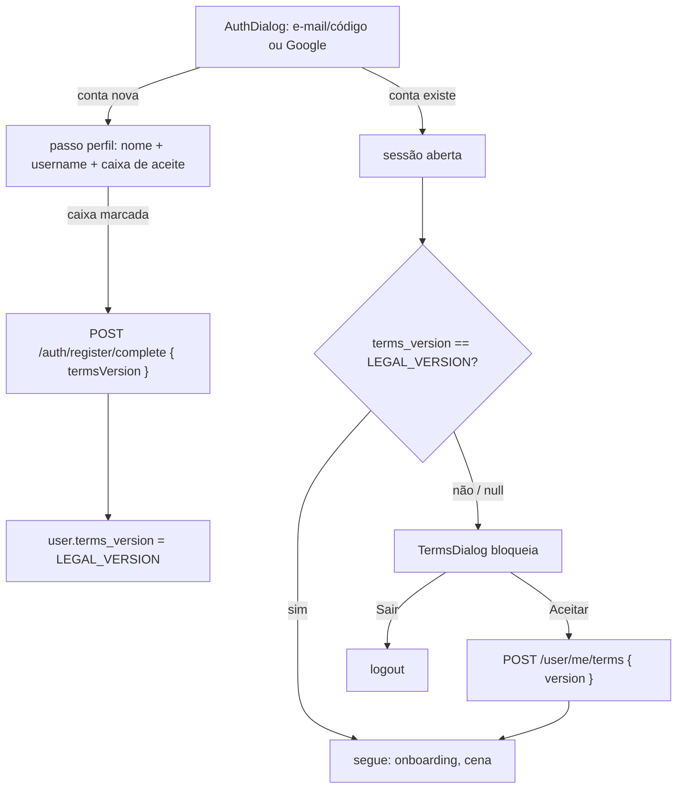

# Termos de Uso e Política de Privacidade

Envio de códigos: **Zoho CPaaS / ZeptoMail** substitui Resend como operador ativo. Política informa processamento fora do Brasil sem presumir região da conta Zoho. Versão main `2026-10-25`; troca de terceiro exige novo aceite pelo fluxo existente. Backend preserva Resend desativado; reativação exige atualizar política e versão antes do deploy.

Duas páginas públicas + aceite no login. Base: lei brasileira (LGPD, Marco Civil, CDC) e requisito do Google para login (link da política na home, mesmo domínio). Texto revisado por agentes (ver [[#Agentes]]), **não** por advogado — validar antes de escalar.

> [!important] Fonte única
> Edição, versão, data, controlador, e-mail e caminhos: `src/lib/legal.ts`. Texto: `src/pages/legal/Terms.tsx` e `src/pages/legal/Privacy.tsx`. Layout: `src/pages/legal/LegalPage.tsx`.

---

## Duas edições

Mesmo código nas duas branches; só `LEGAL_EDITION` (`src/lib/legal.ts`) muda:

| Branch | `LEGAL_EDITION` | `LEGAL_VERSION` | Texto |
|---|---|---|---|
| `beta` (produção hoje, pré-lançamento) | `"prelaunch"` | `2026-10-15-beta` | Tudo simulado: sem pagamento, simulação só no navegador, seção "Pré-lançamento: tudo é teste", ONGs não recebem dado |
| `main` (lançamento) | `"launch"` | `2026-10-25` | Pix via **Woovi** direto para a conta da ONG (Cidoe não recebe nem repassa dinheiro), edifício público, devolução encaminhada à ONG |

- Texto comum escrito uma vez; `IS_PRELAUNCH ? … : …` só onde difere. Seção exclusiva entra com `...(IS_PRELAUNCH ? [secao] : [])`.
- Edição faz parte da versão → quem aceitou na beta aceita de novo quando a main for ao ar. Sem passo manual.
- Merge `main → beta` mantém a linha da beta (só a beta mexe nela). Nunca commitar `"prelaunch"` na main.
- Documentos valem só para **usuários** (com ou sem conta, e quem escreve ao contato). ONGs terão termos próprios quando o cadastro de ONGs abrir.

> [!danger] main não vai ao ar antes da integração Woovi
> O texto `launch` afirma que o Pix é gerado pela Woovi direto para a conta da ONG. Hoje a main só tem `PIX_SIMULATED` (nunca em produção) com `receiverName: "Cidoe"`. Publicar a main antes da integração = texto falso.

---

## Rotas

| Rota | Arquivo | Sessão |
|---|---|---|
| `/termos` | `src/pages/legal/Terms.tsx` | nenhuma — fora do `AuthProvider` |
| `/privacidade` | `src/pages/legal/Privacy.tsx` | nenhuma — fora do `AuthProvider` |

Lazy em `src/App.tsx`. Nginx já cai no `index.html` (`try_files … /index.html`), URL direta funciona. Body da app tem `overflow: hidden` (cena), então `LegalPage` rola no próprio `<main>`.

Links:
- `<noscript>` no `index.html`: descrição do site + links legais para robô sem JavaScript (verificação do Google).
- Rodapé da home ([[html-components#DonationInfoSection.tsx|DonationInfoSection]]) — exigência do Google: política linkada na página inicial.
- Caixa de aceite (`TermsConsent`) — abre em **nova aba**: prova do e-mail do cadastro vive só no estado React, sair da aba perderia o cadastro.
- Entre os dois documentos (menu lateral do `LegalPage`).

`LegalPage` = DS de página fora da cena: `bg-background pattern-paws`, kicker mono com a versão, título display, índice de seções (sticky no desktop), texto em placa `pixel bevel-edge bg-card`. Corpo em Manrope (DS proíbe mono em termo legal).

---

## Aceite no login

- **Caixa** (`TermsConsent` em `src/components/TermsDialog.tsx`): "Tenho 18 anos ou mais, aceito os Termos de Uso e li a Política de Privacidade." Aceita o contrato, dá ciência da política (política ≠ consentimento, LGPD art. 8º §4º). Nunca pré-marcada. Botão **Criar conta** desabilitado até marcar; `AuthDialog.reset()` desmarca.
- **Cadastro**: `completeRegistration({ …, termsVersion: LEGAL_VERSION })`. Back recusa cadastro sem `termsVersion` (Zod), grava `terms_version` + `terms_accepted_at = NOW()` e uma linha `signup` no histórico.
- **Reaceite** (`TermsDialog`): abre quando `user.terms_version !== LEGAL_VERSION` — conta anterior aos termos (`null`, título "Termos de Uso") ou versão antiga ("Termos atualizados"). Sem X, Esc ou clique fora; saída = **Sair** (logout). Sucesso atualiza `user` → fecha sozinho.
- **Prioridade**: `AuthMenu` segura `ReferralDialog` e `OnboardingDialog` enquanto `needsTerms`. Ver [[html-components#OnboardingDialog.tsx]].
- `AuthProvider.acceptTerms` segue padrão `sessionVersion` (resposta de sessão antiga não sobrescreve usuário).

### Backend (`cidoa-back`)

| Peça | O quê |
|---|---|
| Migration `0021_user_terms_acceptance.sql` | `user.terms_version` + `user.terms_accepted_at` (último aceite, checagem rápida) e `user_terms_acceptance` (histórico só de inclusão: versão, `method` `signup`/`reaccept`, IP, user-agent, data; CASCADE com a conta) |
| `termsVersionSchema` (`user.schema.ts`) | `YYYY-MM-DD` + sufixo opcional `-[a-z]{1,8}` (edição); back não conhece versão vigente — grava a que o front mostrou |
| `completeRegistrationSchema` | `termsVersion` obrigatório |
| `POST /user/me/terms` | `{ version }` → grava versão + data no usuário e linha `reaccept` no histórico, devolve `PublicUser` |
| `PublicUser` | expõe `terms_version`, `terms_accepted_at` |

> [!warning] Deploy junto
> `termsVersion` obrigatório no back + `.strict()`: front antigo (sem o campo) não cadastra; back antigo recusa campo desconhecido. Ordem: migration 0021 → back → front, na mesma janela.
>
> **Produção hoje = front `beta`.** Subir a beta com estas páginas e o aceite junto com o back (beta antiga não envia `termsVersion` → nenhum cadastro funciona). Sem isso o Google também não acha a política.

---

## Mudar os termos

1. Editar texto em `Terms.tsx` / `Privacy.tsx`.
2. Mudança relevante (dado novo, terceiro novo, finalidade nova, regra nova) → nova data em `LEGAL_DATE` + `LEGAL_UPDATED_AT`. Toda conta vê `TermsDialog` no próximo acesso. Correção de digitação → sem versão nova.
3. Rodar `revisor-termos` (ver [[#Agentes]]) antes de publicar.

---

## Agentes

Definidos em `.claude/agents/` (carregam em sessão nova do Claude Code):

| Agente | Papel |
|---|---|
| `auditoria-termos` | Varre front (main + beta) e back; acha dado coletado, terceiro, cookie, retenção e risco de exibição errada/remoção/teste, com `arquivo:linha` + cláusula sugerida |
| `pesquisa-legal` | LGPD, Marco Civil, CDC, ANPD, requisitos do Google; checklist com fonte primária; o que é nulo |
| `revisor-termos` | Confere textos contra pedidos do dono, lei, Google e código; veredito + correções |

Rodar de novo quando: feature nova coleta dado, entra terceiro (PSP, analytics), muda retenção, ou antes de sair do pré-lançamento.

---

## Pendências fora do texto

Achados de `auditoria-termos` + `pesquisa-legal` (15/10/2026) que o texto contorna mas o produto ainda deve resolver:

- **Integração Woovi (antes de ativar Pix real)** — o texto da main já promete:
  - recebedor do Pix = conta da ONG na Woovi (hoje o simulado mostra `receiverName: "Cidoe"`);
  - enviar à Woovi só valor, ONG e código da cobrança (sem nome, e-mail ou CPF) e **descartar** nome/CPF do pagador que vierem na confirmação;
  - cancelar na Woovi a cobrança substituída ("gerar novo código invalida o anterior"); se um código antigo for pago mesmo assim, registrar a contribuição;
  - devolução e MED por webhook → reduzir ou remover o edifício;
  - corrigir cobrança paga com edifício apagado aparecendo "expirada" e pagamento com destino inválido.
- Dono decidiu não publicar documento (CPF) na página.
- **Aviso no perfil**: Termos prometem avisar remoção e resultado de denúncia **no perfil do usuário** (não por e-mail). Hoje o perfil não tem área de avisos — criar antes de remover conteúdo de alguém.
- **Dados de teste em produção**: `POST /admin/test-buildings` sem trava de ambiente e sem marca de teste; `DELETE` apaga doações reais; ONGs do seed são fictícias e somam em "Total arrecadado".
- **main**: campo "doar"/"gerar" visível a qualquer visitante (beta já restringe a admin).
- **Holograma** sem reencode (pode levar EXIF/GPS); foto do Google guardada como URL.
- ~~**Terceiros em todo acesso**~~ resolvido: fontes self-hosted (`public/fonts`) e GIS só baixa ao abrir login (ou ponteiro no "Entrar") — ver [[html-components#Carregamento inicial (casca)]]. Visitante que não loga não fala com Google (exceto Analytics após aceite).
- **Titular**: sem exclusão/exportação pela interface (hoje por e-mail, admin executa); exclusão não limpa `email_suppression` (declarado na política).
- **Operacional** (promessas do texto): confirmar denúncia e analisar em até 30 dias; responder ao denunciante pelo contato da denúncia; imagem íntima com prioridade máxima; comunicar às autoridades conteúdo de abuso infantil; avisar remoção no perfil (exceto teste/pedido do usuário); dar o motivo de suspensão/exclusão por e-mail a pedido; contestação em até 30 dias e resposta em até 30 dias; corrigir registro em 10 dias úteis; encaminhar pedido de devolução à ONG; responder titular em 15 dias; guardar mensagens até 1 ano após o assunto fechar; aviso de encerramento com 30 dias; comunicar incidente à ANPD; beta: devolver valor pago por engano. Relatório anual de denúncias **não** foi prometido (vinha de decreto não confirmado).
- **Prova do aceite** some com a conta (CASCADE). Guardar 5 anos após exclusão (CDC art. 27) exige `SET NULL` + hash do e-mail e mudar a retenção da política.
- **Validar com advogado** os decretos citados pela pesquisa (Decreto 12.975/2026 → arts. 16-E/20-A do Decreto 8.771; Decreto 12.976/2026) e se a autodeclaração 18+ basta perante o ECA Digital (cidade pública com conteúdo de usuário sem moderação prévia).
- **Fatos do dono já no texto**: hospedagem no Brasil; backups por até 3 meses (mais antigos apagados); controlador pessoa física sem documento na página.
- **Runbook de backup contradiz a política** (`cidoa-back/dev/prod/server/006-escalabilidade-operacao.md`): usa `-mtime +14` (14 dias) → passar para `+90`; sugere cópia externa em S3/B2/Drive (fora do Brasil) → manter no Brasil ou declarar a transferência na política.
- **Caixa `contato@cidoe.com.br`**: provedor e país (se fora do Brasil, declarar em "Transferência para fora do Brasil").
- **Recompensas do pré-lançamento**: texto da beta diz que continuam valendo no lançamento (tela promete recompensa — CDC art. 30). Confirmar.
- **Beta e main no ar ao mesmo tempo** contra o mesmo banco: cada troca de site pede reaceite. Manter só uma no ar.
- **Dono**: prazo dos logs do proxy HTTPS do host; e-mail de suporte no console do Google (conta Google ou grupo administrado); URLs `/`, `/privacidade`, `/termos` no console depois do deploy.

---

Ver também: [[index]], [[html-components]], [[area-admin]], [[desingn-system-index]].

## Duração do cookie administrativo

Política de Privacidade: `token_admin` dura 30 dias ou até sair. Mesmo prazo do JWT administrativo, fixado no código do backend, sem variável de ambiente. Sessão administrativa exige novo login para receber novo prazo.
