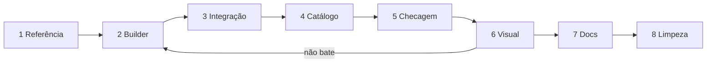

# Novo Edifício

Guia ponta a ponta pra **criar ou editar** modelo de edifício autoral (formato do catálogo `shape`). Padrão de código: [[scene-builders#createResidentialBuildingMesh.ts]]. Exemplo recente completo: [[scene-builders#createYachthouseBuildingMesh.ts]].



## 1. Referência

Medir antes de modelar. Chute de proporção = modelo que "não lembra o prédio".

- Proporção: largura × profundidade × vão entre volumes, recuos, altura do embasamento. Contar pixel na imagem, comparar razões (ex.: vão/largura da torre ≈ 1/5 no Yatchcasa)
- Cor: média de pixel de cada material (faixa, vidro, revestimento). Separar face iluminada de face na sombra
- Detalhe por vista: frente, fundos, topo, base. Zoom (círculos da ref.) diz material e acabamento
- Recorte/zoom pra medir (macOS): `sips -c <alt> <larg> --cropOffset <y> <x> ref.png --out "$TMPDIR/crop.png"` e `sips -z <alt> <larg>` pra ampliar. Cor média: `sips -s format bmp` + ler bytes com Python sem lib. Tudo em pasta temporária → ver [[#8. Limpeza]]

> [!warning] Referência do dono
> Imagem que o dono mandou fica onde ele pôs. Não apagar, não versionar, não copiar pro repo sem pedir.

## 2. Builder

Arquivo `src/scene/builders/create<Nome>BuildingMesh.ts`. Factory, sem classe.

- **Metros**, escala pra unit box uma vez no fim: `scale(1/lote, 1/total, 1/lote)` + `translate(0, -0.5, 0)`. Mesh 1×1×1 (Y exato); quem escala é a cena (lote 2×2, altura 0,5–16)
- Geometria **não indexada**; `mergeGeometries` por slot → **1 grupo = 1 draw call por material**
- Slot 0 = `facadeMaterial` (recebe **cor da customização**), slot 1 = `topMaterial` (concreto global). Demais: `createSceneMaterial(envMap, …)` — marca `authoredEnvMapIntensity`, reflete a cidade, segue modo noite
- `clearTextureSlots(facadeMaterial)` → manager não joga textura global por cima
- `aProjPosition`/`aProjNormal` = cópia de `position`/`normal` (shader triplanar lê)
- Andar pela altura (opcional): `get<Nome>FloorCount(height)`, cache de geometria por nº de andares, `set<Nome>BuildingHeight(mesh, height)`
- `ExtrudeGeometry` de planta: `rotateX(-π/2)`, ponto `(x, z)` → `Vector2(x, -z)`. Grupos do Extrude: **0 = tampas, 1 = laterais** — separar quando tampa e lateral pedem material diferente (`band()` do Yatchcasa: lateral dourada, tampa escura)
- `dispose<Nome>BuildingSharedResources()` libera cache
- Sem sombra ([[scene-runtime]]: luz = ambiente + IBL)

> [!tip] Cor na luz da cena
> Ambiente ~8 + ACES 1,45: tom claro estoura pra branco/creme. Albedo bem mais escuro que a cor percebida na ref. (dourado `0xa67c3e` lê "dourado leve"; `0xc9a56c` lê creme). Calibrar com `--slot` no [[#6. Visual]] antes de fixar constante.

## 3. Integração

Todo ponto que trata formato autoral. Achar todos: `grep -rn '"residential"' src`.

| Arquivo | O quê |
| --- | --- |
| `src/scene/types.ts` | key no union [[scene-types#BuildingShape]] |
| `createBuildingShapeMesh.ts` | `SHAPE_BUILDERS` + dispose em `disposeBuildingShapeSharedResources` ([[scene-builders#createBuildingShapeMesh.ts]]) |
| `createDonationManager.ts` | cor só se ≠ global; `setResidentialStoneMaps` se slot 0 usa concreto; setter de altura no sync; `positionRooftop` (escala/offset do acessório) → [[scene-managers]] |
| `createPreviewScene.ts` | altura da prévia, mapas, escala/offset do acessório de topo |
| `createSignMesh.ts` · `createEdgeLightMesh.ts` | contorno real (tiers) quando planta ≠ caixa |
| `createParapetMesh.ts` | formato com coroamento próprio cai no `default` do switch → `null` |
| `scripts/render-building.mjs` | `HEIGHT_SETTERS` se andar segue altura |

## 4. Catálogo (backend)

- `cidoa-back`: migration **nova** numerada insere opção na categoria `shape`. Migration aplicada é imutável: renomear = migration nova
- Key = contrato com front e com `donation.customization` já gravado → nunca muda; renomear só `label`
- `npm run migrate` no `cidoa-back`; cache público do catálogo até 60 s. Ver [[customization-api]]

## 5. Checagem

```bash
node scripts/check-building-shapes.mjs   # todo formato de BUILDING_SHAPES entra sozinho
npx tsc -b
npx eslint src/scene scripts
```

Formato autoral ganha bloco próprio no `check-building-shapes.mjs`: nº de slots/grupos na ordem, atributos finitos, raycast em vão/rasgo característico, andares por altura + cache, piso/teto de andares, footprints e offset de topo, `authoredEnvMapIntensity`, dispose. Função nova exportada → arquivo na lista do bundle no topo do script.

## 6. Visual

`scripts/render-building.mjs` — render headless com a luz da cidade, **genérico**: formato novo não pede script novo. Faltou opção → estender este, não criar harness avulso.

```bash
node scripts/render-building.mjs yachthouse --height 4.5 --ref "Yatchcasa .png"
node scripts/render-building.mjs yachthouse --slot 2=24405e,0.9,0.05   # calibrar vidro (cor, metal, rough)
node scripts/render-building.mjs yachthouse --color c0392b              # cor da customização
```

| Opção | Efeito |
| --- | --- |
| `<formato>` | key de `BUILDING_SHAPES`; desconhecida → erro escrito no PNG com a lista |
| `--height <n>` | altura na cena (padrão 4); setter de andares aplicado |
| `--ref ` | referência 640×640 ao lado |
| `--color <hex>` | cor da customização, aplicada como no manager (Empire via `setEmpireBuildingMeshColor`) |
| `--slot <i>=<hex>[,metal[,rough]]` | sobrescreve material do slot `i`; repetível |
| `--out <png>` | saída; padrão `$TMPDIR/cidoa-render/<formato>.png` (sobrescreve, 1 por formato) |

- PNG: 4 vistas 480×640 — 3/4 frente (az 35°), 3/4 fundos (az 215°), topo (28% de cima), base (28% de baixo). Câmera encaixa a caixa do trecho
- Fiel: HDRI do céu (IBL + fundo), ambiente padrão de [[scene-config]], ACES 1,45, chão `#292929`, materiais base do manager
- Fora: texturas PBR (pedra do residencial sai lisa/clara), parapeito, acessórios, LED, letreiro, envMap dinâmico → conferir no `npm run dev` antes de fechar
- Navegador: env `CHROME`, senão Chrome/Brave/Chromium nos caminhos padrão. SwiftShader: igual com ou sem GPU
- Bundle/HTML em pasta temporária apagada no fim; só PNG sobra
- Ciclo: render → comparar com ref → ajustar constante → render. Agente: `--out` na pasta scratchpad da sessão

## 7. Docs

- Seção do builder em [[scene-builders]]: detalhes modelados, como funciona, API
- [[scene-managers]], [[scene-types]], [[customization-api]], [[index]] (árvore de arquivos + "Onde Mexer?")
- Backend: `cidoa-back/doc/index-doc.md` + `doc/modulos/personalizacoes/personalizacoes.md`

## 8. Limpeza

Antes de encerrar. Nada de print, recorte, bundle ou script descartável no repo nem no temporário.

```bash
rm -rf "${TMPDIR:-/tmp}/cidoa-render"   # PNGs do render-building (ou a pasta do --out)
git status --short                      # só arquivo da entrega
```

- Recorte/zoom da ref., harness avulso, `bundle.js`, `.html`/`.bmp`/`.png` de teste → apagar
- Script novo só se reutilizável: entra em `scripts/` + árvore do [[index]]. Avulso não fica
- Servidor ou navegador headless aberto pra teste → matar **só** o processo aberto (`pkill -f "<comando exato>"`); nunca o navegador do dono
- Cache de geometria é do runtime (`dispose`), nada em disco
